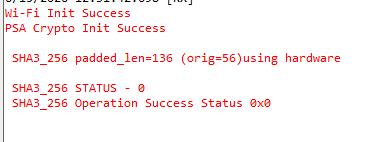

# SiWx91x Platform - PSA SHA3 FreeRTOS

## Table of Contents

- [SiWx91x Platform - PSA SHA3 FreeRTOS](#platform-siwx91x-psa-sha3)
  - [Table of Contents](#table-of-contents)
  - [Purpose/Scope](#purposescope)
  - [Prerequisites/Setup Requirements](#prerequisitessetup-requirements)
    - [Hardware Requirements](#hardware-requirements)
    - [Software Requirements](#software-requirements)
    - [Setup Diagram](#setup-diagram)
  - [Getting Started](#getting-started)
  - [Application Build Environment](#application-build-environment)
  - [Test the Application](#test-the-application)
    - [Expected output](#expected-output)
  - [Troubleshooting](#troubleshooting)
  - [Resources](#resources)
  - [Report Bugs/Support](#report-bugssupport)

## Purpose/Scope

- This application mirrors the **si91x_psa_sha** example (same Wi-Fi bring-up, PSA init, and project layout) but runs **SHA3-224 / SHA3-256 / SHA3-384 / SHA3-512** using the Si91x accelerator API **`sl_si91x_sha3()`**.
- PSA Crypto is initialized for consistency with other SoC crypto examples; the hash operations use the WiseConnect SHA3 driver, not `psa_hash_compute()` (SHA3 is not exposed the same way as SHA-2 in the PSA SHA example).

## Prerequisites/Setup Requirements

Before running the application, the user will need the following things to setup.

### Hardware Requirements

- Windows PC
- Silicon Labs SiWx91x Evaluation Kit [WPK(BRD4002)+ BRD4338A]

### Software Requirements

- Simplicity Studio

### Setup Diagram

  

## Getting Started

Refer to the instructions [here](https://docs.silabs.com/wiseconnect/latest/wiseconnect-getting-started/) to:

- [Install Simplicity Studio](https://docs.silabs.com/wiseconnect/latest/wiseconnect-developers-guide-developing-for-silabs-hosts/#install-simplicity-studio)
- [Install WiSeConnect extension](https://docs.silabs.com/wiseconnect/latest/wiseconnect-developers-guide-developing-for-silabs-hosts/#install-the-wi-se-connect-extension)
- [Connect your device to the computer](https://docs.silabs.com/wiseconnect/latest/wiseconnect-developers-guide-developing-for-silabs-hosts/#connect-si-wx91x-to-computer)
- [Upgrade your connectivity firmware](https://docs.silabs.com/wiseconnect/latest/wiseconnect-developers-guide-developing-for-silabs-hosts/#update-si-wx91x-connectivity-firmware)
- [Create a Studio project](https://docs.silabs.com/wiseconnect/latest/wiseconnect-developers-guide-developing-for-silabs-hosts/#create-a-project)

In Simplicity Studio, you can start from the **SiWx91x Platform - PSA SHA3 FreeRTOS** example; the project file is `examples/si91x_soc/crypto/siwx91x_platform_psa_sha3_freertos/siwx91x_platform_psa_sha3_freertos.slcp`.

For details on the project folder structure, see the [WiSeConnect Examples](https://docs.silabs.com/wiseconnect/latest/wiseconnect-examples/#example-folder-structure) page.

## Application Build Environment

- The user can run the application to verify the following SHA3 modes:
  - SHA3-224
  - SHA3-256
  - SHA3-384
  - SHA3-512
- Enable the desired SHA3 algorithm in [`psa_sha3_app.h`](psa_sha3_app.h) by defining the corresponding macro: `SL_SLI91x_SHA3_224_EN`, `SL_SLI91x_SHA3_256_EN`, `SL_SLI91x_SHA3_384_EN`, or `SL_SLI91x_SHA3_512_EN`.
- By default **SHA3-256** is enabled (same idea as SHA-256 being the default in `si91x_psa_sha`).

> **Note**: For recommended settings, please refer the [recommendations guide](https://docs.silabs.com/wiseconnect/latest/wiseconnect-developers-guide-prog-recommended-settings/).

> **Note**: To enable **sideband crypto**, Use **one** of the following methods, depending on your workflow:
>
> **Option 1 — Edit the example's `.slcp` file (the `.slcp` inside the example folder, not the project `.slcp`):**
>
> Add the `define` entry at example scope:
>
> ```yaml
> define:
>   - name: SL_SI91X_SIDE_BAND_CRYPTO
> ```
>
> **Option 2 — Add the macro using Configurators 2.0:**
>
> 1. Create the desired PSA example project and open it in any compatible IDE.
> 2. In the project explorer, right-click the project and select **Open Configurators 2.0**.
>
>    
>
> 3. In the configurator view, switch to the **Build Configurator** tab.
>
>    
>
> 4. Under **Compiler Flags → C**, add `-DSL_SI91X_SIDE_BAND_CRYPTO` to the options list and save the configuration.
>
>    
>
> 5. **Clean** the project and then **rebuild** it for the change to take effect.


## Test the Application

Refer to the instructions [here](https://docs.silabs.com/wiseconnect/latest/wiseconnect-getting-started/) to:

- Build the application.
- Flash, run and debug the application.

### Expected output

- User will get the digest value and success/fail comparison against known-good vectors for the standard test message (same message string as in `si91x_psa_sha`).

  

Follow the steps as mentioned for the successful execution of the application:

- [AN1311: Integrating Crypto Functionality Using PSA Crypto Compared to Mbed TLS Guide](https://www.silabs.com/documents/public/application-notes/an1311-mbedtls-psa-crypto-porting-guide.pdf)

- [AN1135: Using Third Generation Non-Volatile Memory (NVM3) Data Storage](https://www.silabs.com/documents/public/application-notes/an1135-using-third-generation-nonvolatile-memory.pdf)

## Troubleshooting

- If the project does not build, ensure Simplicity Studio and the WiSeConnect extension are installed and the board is connected.
- **Linker: `undefined reference to mbedtls_sha3_*`**: Mbed TLS `psa_crypto_hash.c` calls `mbedtls_sha3_init`, `mbedtls_sha3_free`, and related symbols whenever PSA SHA-3 support is enabled in that SDK build. Add the Simplicity SDK software component **`mbedtls_sha3`** to the project (same package as `psa_crypto`, no `from:` vendor). That pulls in `sha3.c` so the link succeeds; you can still use **`sl_si91x_sha()`** for hardware SHA3 in application code.
- **Linker: `sli_si91x_host_allocate_buffer` / `sli_si91x_host_init_buffer_manager`**: Include **`sl_si91x_basic_buffers`**, **`sl_si91x_wireless`**, and **`wiseconnect_common`** as in the example `.slcp`.
- If the device is not detected, reinstall the connectivity firmware and check USB drivers.

## Resources

- [WiSeConnect Getting Started](https://docs.silabs.com/wiseconnect/latest/wiseconnect-getting-started/)
- [WiSeConnect Examples](https://docs.silabs.com/wiseconnect/latest/wiseconnect-examples/)
- [SiWx91x SoC Documentation](https://docs.silabs.com/wiseconnect/latest/)

## Report Bugs/Support

For issues and support, use the Silicon Labs Community or your normal support channel.