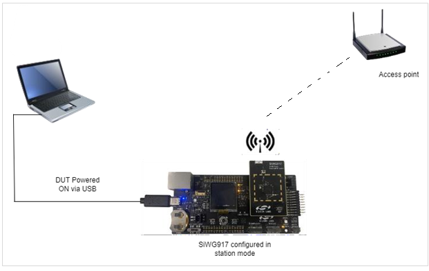
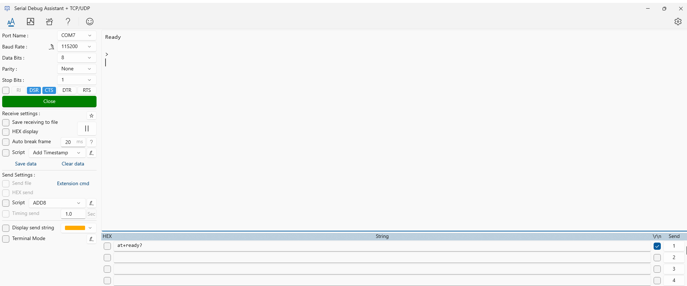
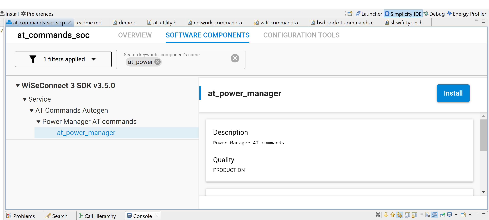

# AT Commands

## Table of Contents

- [AT Commands](#at-commands)
  - [Table of Contents](#table-of-contents)
  - [Purpose/Scope](#purposescope)
  - [Prerequisites/Setup Requirements](#prerequisitessetup-requirements)
    - [Hardware Requirements](#hardware-requirements)
    - [Software Requirements](#software-requirements)
    - [Setup Diagram](#setup-diagram)
  - [Getting Started](#getting-started)
  - [Setup from Empty Project](#setup-from-empty-project)
  - [Application Build Environment](#application-build-environment)
  - [Test the Application](#test-the-application)
    - [Powersave Commands](#powersave-commands)
    - [TWT Commands](#twt-commands)
  - [Creating a new command handler](#creating-a-new-command-handler)
    - [Argument types](#argument-types)

## Purpose/Scope

The AT Commands application is a Command-Line Interface (CLI) application designed to showcase various functionalities and capabilities of SiWx91x in different scenarios and configuration modes. It serves as a quick reference guide and a hands-on demonstration of SiWx91x core features for developers and users.

## Prerequisites/Setup Requirements

### Hardware Requirements

- A Windows PC.
- 802.11 ax/b/g/n access point - For Signaling mode or End-to-End mode testing.
- Spectrum Analyzer for TX RF measurement (PER-TX) - For Non -signaling mode testing. 
- Signal Generator for RX RF measurement (PER_RX) - For Non-signaling mode testing. 
- A Micro-coaxial connector plug to SMA-female cable (RF connector) for connecting the U.Fl port of the Si917 radio board to the Spectrum Analyzer or Signal Generator.
- **SoC Mode**:
  - Standalone
    - BRD4002B Wireless Pro Kit Mainboard [SI-MB4002B]
    - Radio Boards 
  	  - BRD4338A [SiWx917-RB4338A]
      - BRD4339B [SiWx917-RB4339B]
  	  - BRD4340A [SiWx917-RB4340A]
  	  - BRD4343A [SiWx917-RB4343A]
  - Kits
  	- SiWx917 Pro Kit [Si917-PK6031A](https://www.silabs.com/development-tools/wireless/wi-fi/siwx917-pro-kit?tab=overview)
  	- SiWx917 Pro Kit [Si917-PK6032A]
    - SiWx917 AC1 Module Explorer Kit (BRD2708A)

### Software Requirements

- Simplicity Studio
- A Serial terminal software such as [Serial Debug Assistant](https://apps.microsoft.com/detail/9NBLGGH43HDM?rtc=1&hl=en-in&gl=in)

Note : The user can also use the Simplicity studio’s console window for sending and receiving the CLI command but it is recommended to use Serial Debug Assistant for ease of the command usage.


### Setup Diagram

- The figure below shows the setup and the connections for SiWG917 in Station mode.




## Getting Started

Refer to the instructions [here](https://docs.silabs.com/wiseconnect/latest/wiseconnect-getting-started/) to:

- [Install Simplicity Studio](https://docs.silabs.com/wiseconnect/latest/wiseconnect-developers-guide-developing-for-silabs-hosts/#install-simplicity-studio)
- [Install WiSeConnect extension](https://docs.silabs.com/wiseconnect/latest/wiseconnect-developers-guide-developing-for-silabs-hosts/#install-the-wi-se-connect-extension)
- [Connect your device to the computer](https://docs.silabs.com/wiseconnect/latest/wiseconnect-developers-guide-developing-for-silabs-hosts/#connect-si-wx91x-to-computer)
- [Upgrade your connectivity firmware ](https://docs.silabs.com/wiseconnect/latest/wiseconnect-developers-guide-developing-for-silabs-hosts/#update-si-wx91x-connectivity-firmware)
- [Create a Studio project ](https://docs.silabs.com/wiseconnect/latest/wiseconnect-developers-guide-developing-for-silabs-hosts/#create-a-project)

For project folder structure details, see the [WiSeConnect Examples](https://docs.silabs.com/wiseconnect/latest/wiseconnect-examples/#example-folder-structure) page.


## Setup from Empty Project

Use this section when building the application from a minimal/empty template so you can see which software components and configurations the feature needs. Creating the example from **Example Projects & Demos** installs these automatically.

The component and configuration list below is for the SoC project.

1. In Simplicity Studio, create a **SiWx91x Platform - Empty C FreeRTOS** project for your board (or another minimal Wi-Fi SoC empty template if available).
2. Open the project `.slcp` file, select the **Software Components** tab, and install the components below (search by label or component ID).
3. Apply the listed configurations and preprocessor defines.
4. Copy this example's `app.c` and `app.h` into the project (replace the empty-project sources).
5. Configure credentials and application parameters as described in [Application Build Environment](#application-build-environment).
6. Build, flash, and run.

### Core / RTOS

- **sl_main (System Init)** (`sl_main`)
- **FreeRTOS** (`freertos`)
- **FreeRTOS Heap 3** (`freertos_heap_3`)
- **Memory Manager** (`memory_manager`)
- **System Calls** (`syscalls`)
- **Default RAM Memory Configuration** (`si91x_memory_default_config`)

### Wi-Fi / networking

- **WiSeConnect Common Library** (`wiseconnect_common`)
- **Wi-Fi** (`wifi`)
- **Offload Network Stack** (`sl_si91x_internal_stack`)
- **WiSeConnect Resources** (`wifi_resources`)
- **Network Manager** (`network_manager`)
- **Basic Network Configuration Manager** (`basic_network_config_manager`)
- **RAM Execution** (`device_needs_ram_execution`)
- **IoT Socket** (`iot_socket`)
- **Soft Reset** (`sl_si91x_soc_soft_reset`)
- **AT Commands Autogen** (`at_commands_auto_gen`)
- **Wi-Fi AT commands** (`wifi_at_commands`)
- **Network AT commands** (`net_at_commands`)
- **BSD socket AT commands** (`bsd_socket_at_commands`)
- **MQTT AT commands** (`mqtt_at_commands`)
- **MQTT Client** (`mqtt`)
- **HTTP AT commands** (`http_at_commands`)
- **HTTP Client** (`http_client`)
- **BLE AT commands** (`ble_at_commands`)
- **BLE** (`ble`)
- **File System AT commands** (`fs_at_commands`)
- **Little FS for Common Flash** (`sl_si91x_littlefs_common_flash`)
- **Firmware Update AT commands** (`fwup_at_commands`)
- **UART Configuration AT commands** (`uart_at_commands`)
- **UART** (`sl_uart`)

### Power / wakeup

- **Power Manager AT commands** (`at_power_manager`)

### Console / logging

- **IO Stream RTT** (`iostream_rtt_si91x`)
- **IO Stream: RTT** (`iostream_rtt`)
- **Log - None** (`log_none`)
- **SL Log Core** (`si91x_log`)
- **Log Backend I/O Stream - Formatted Output** (`si91x_log_iostream_formatted`)

### Required configurations

In the `.slcp` **Configuration** view (and Board Control / wakeup components where applicable), set:

- `SL_LOG_CONFIG_LEVEL_COMPILE_TIME` = `SL_LOG_CONFIG_LEVEL_INFO`
- `SL_BOARD_ENABLE_VCOM` = `1`
- `NVM3_DEFAULT_MAX_OBJECT_SIZE` = `280`
- `SL_ENABLE_CALENDAR_WAKEUP_SOURCE` = `1`
- `ENABLE_ALARM` = `1`
- `ALARM_TIME_MSEC` = `30000`
- `UART_UC` = `0`
- `USART_UC` = `0`
- `ULP_UART_UC` = `0`

### Preprocessor defines

In the `.slcp` **Defines**, add:

- `SL_SI91X_CLI_CONSOLE_MAX_ARG_COUNT` = `30`
- `SLI_SI91X_DBG_MIDDLEWARE_EN`
- `SLI_SI91X_MCU_INTR_BASED_RX_ON_UART`
- `SLI_AT_COMMAND_SUPPORT`
- `SLI_CONSOLE_SUPPRESS_AUTO_ECHO`
- `SLI_SI91X_CONFIG_WIFI6_PARAMS`
- `SLI_SI91X_ENABLE_TWT_FEATURE`

### Feature-specific notes

- The AT commands application is a command-line interface (CLI) application designed to showcase various functionalities and capabilities of SiWx91x in different scenarios and configuration modes.

> **Tip**: Prefer creating the sample from Example Projects when you only need to run the demo. Use this empty-project path when integrating the feature into your own application.
## Application Build Environment

The application can be configured to suit your requirements and development environment.

- The application uses the default configurations as provided in the **wifi_commands.c** and you can choose to configure these parameters as needed.

> **Note**: For recommended settings, please refer the [recommendations guide](https://docs.silabs.com/wiseconnect/latest/wiseconnect-developers-guide-prog-recommended-settings/).

## Test the Application

See the instructions [here](https://docs.silabs.com/wiseconnect/latest/wiseconnect-getting-started/) to:

- Build the application in Studio.
- Flash, run, and debug the application.



### Powersave Commands

To use the powersave commands, follow the steps below to install the at_power_manager component:

1. Open the `.slcp` file in Simplicity Studio and navigate to the `SOFTWARE COMPONENTS` section.
2. Search for `at_power_manager`. In the WiSeConnect SDK, click on `Expand All`.
3. Select the `at_power_manager` component. In the right-side pane, click on `Install`.



> **Note:**
- By default, the `SL_SI91X_TICKLESS_MODE=1` macro is enabled.
For testing power manager sleep and standby modes, modify the macro to `SL_SI91X_TICKLESS_MODE=0` in the Studio Preprocessor Settings.

 **Here is a list of commands:**

1. at+net-init=8
2. at+net-cred-wifipsk=1,Silabs123
3. at+net-sta-cred=0,SiLabsAP,1
4. at+net-up=8
5. at+wifisys-fwver?
6. at+wifi-get-mac
7. at+net-deinit
8. at+siwx91x-nvic-reset
9. at+ready?
10. at+echo=1

    And so on...

### TWT Commands

Target Wake Time (TWT) requires an 11ax AP that supports TWT. The STA must be
connected (`at+net-up`) before enabling TWT.

This example turns on 802.11ax configuration at NWP init with
`SLI_SI91X_CONFIG_WIFI6_PARAMS` in `at_commands_soc.slcp`. That is the host
define that sends 11ax parameters (including TWT support in the 11ax request).
`SLI_SI91X_ENABLE_TWT_FEATURE` is present for consistency with other TWT
examples; it is not a host compile switch that enables or disables the TWT
AT commands.

TWT commands wait for the TWT response event (up to 5 seconds) before
completing. `OK` means a success event was received (`+TWT:SETUP_OK`,
`+TWT:UNSOLICITED_OK`, `+TWT:TEARDOWN_OK`, or `+TWT:AP_TEARDOWN`). A reject
or other failure event completes the command with `ERROR`. If no event
arrives before the wait expires, the command returns a timeout error. Later
unsolicited TWT events still print as `+TWT:...` lines.

**Recommended sequence (Auto-TWT, for power estimation):**

1. `at+net-init=8`
2. `at+net-cred-wifipsk=1,<password>`
3. `at+net-sta-cred=0,<ssid>,1`
4. `at+net-up=8`
5. `at+wifi-twt-auto=1,0,0,60000` — Auto-TWT setup (`enable`, `avg_tx_kbps`,
   `tx_latency_ms`, `rx_latency_ms`). Defaults if args omitted: `1,0,0,60000`.
6. `at+wifi-perf-prof=2,0,0,0,0` — associated power save low latency
   (`ASSOCIATED_POWER_SAVE_LOW_LATENCY`).
7. Use existing MCU sleep commands from `at_power_manager` (for example
   `at+m4-deep-sleep`).
8. Teardown the auto-TWT session with `at+wifi-twt-auto=0,0,0,60000`.

**Manual iTWT:**

- `at+wifi-enable-twt[=flow_id,wake_duration,wake_int_exp,wake_int_mantissa,req_type]`
  Optional args default to featured-example values (`flow_id=1`,
  `wake_duration=0x60`, `wake_int_exp=13`, `wake_int_mantissa=0x1D4C`,
  `req_type=1` Suggest). Remaining TWT fields use fixed defaults
  (implicit/unannounced, and so on).
- `at+wifi-disable-twt[=flow_id]` — default `flow_id=0xFF` tears down all
  manual sessions started with `at+wifi-enable-twt`.

Use auto-TWT setup and teardown together (`at+wifi-twt-auto`). Use manual
setup and teardown together (`at+wifi-enable-twt` / `at+wifi-disable-twt`).
Do not mix the two APIs on the same session.

## Creating a new command handler

Command handlers consist of two parts:
1. A function that prepares the function arguments and calls the target API.
Metadata that goes into the SLC component file, which is used to generate the command database.
2. The metadata is stored in the template_contribution section of the SLCC file under the name console_commands.

Sample command handler metadata:
```
template_contribution:
  - name: console_commands
    value:
      my_command: # This is the string used to identify the command
        handler: my_command_handler # This is the name of the command handler function
        arguments:
          # Arguments can be as simple as specifying the type
          - int32
          # Arguments can also be provided with 'type'
          - type: uint8
          # This represents all remaining data on the command line
          - "*"
```

The command handler function must have the following syntax:

```
sl_status_t my_command_handler(const console_args_t *arguments)
```
### Argument types

|String|Representation|
|------|--------------|
|uint8|unsigned integer|
|uint16|unsigned integer|
|uint32|unsigned integer|
|int|signed integer|
|int8|signed integer|
|int16|signed integer|
|int32|signed integer|
|string|string|
|hex|Data represented is hexadecimal|
|*	| All remaining command line data|
