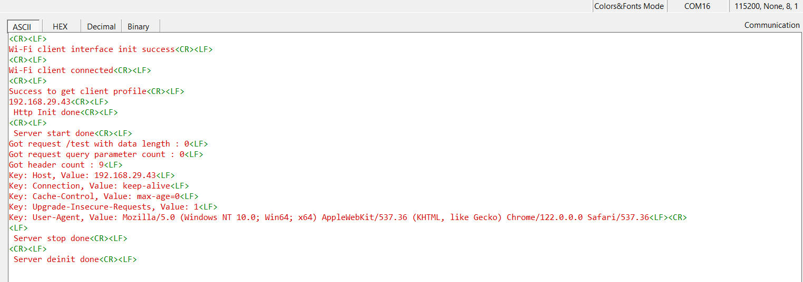

# Wi-Fi - HTTP Server

## High-Level Overview

Demonstrates how to run a Wi-Fi station with an HTTP server and multiple URI handlers using Wi-Fi.

## Table of Contents

- [Wi-Fi - HTTP Server](#wi-fi---http-server)
  - [Table of Contents](#table-of-contents)
  - [High-Level Overview](#high-level-overview)
  - [Purpose/Scope](#purposescope)
  - [Prerequisites/Setup Requirements](#prerequisitessetup-requirements)
    - [Hardware Requirements](#hardware-requirements)
    - [Software Requirements](#software-requirements)
  - [Getting Started](#getting-started)
  - [Setup from Empty Project](#setup-from-empty-project)
  - [Application Build Environment](#application-build-environment)
  - [Test the Application](#test-the-application)
  - [Troubleshooting](#troubleshooting)
  - [Resources](#resources)
  - [Report Bugs and Get Support](#report-bugs-and-get-support)

## Purpose/Scope

This application demonstrates how to configure the SiWx91x device as an HTTP server. In this application, the SiWx91x is configured as a Wi-Fi station and connects to an access point and starts an HTTP Server.

## Prerequisites/Setup Requirements

### Hardware Requirements

- Windows PC
- SoC Mode:
  - Standalone
    - BRD4002B Wireless Pro Kit Mainboard [SI-MB4002B](https://www.silabs.com/development-tools/wireless/wireless-pro-kit-mainboard?tab=overview)
    - Radio Boards 
	  - BRD4338A [SiWx917-RB4338A](https://www.silabs.com/development-tools/wireless/wi-fi/siwx917-rb4338a-wifi-6-bluetooth-le-soc-radio-board?tab=overview)
	  - BRD4342A [SiWx917-RB4342A](https://www.silabs.com/development-tools/wireless/wi-fi/siwx91x-rb4342a-wifi-6-bluetooth-le-soc-radio-board?tab=overview)
	  - BRD4339B [SiWx917-RB4339B](https://docs.silabs.com/wiseconnect/latest/wiseconnect-getting-started/getting-started-with-at)
	  - BRD4340A [SiWx917-RB4340A](https://docs.silabs.com/wiseconnect/latest/wiseconnect-getting-started/getting-started-with-at)
	  - BRD4343A [SiWx917-RB4343A](https://www.silabs.com/development-tools/wireless/wi-fi/siw917y-rb4343a-wi-fi-6-bluetooth-le-8mb-flash-radio-board-for-module?tab=overview)
	  - BRD4343C [SiWx917-RB4343C](https://www.silabs.com/development-tools/wireless/wi-fi/siw917y-rb4343c-wi-fi-6-bluetooth-le-8mb-flash-radio-board-for-module?tab=overview)
  - Kits
	  - SiWG917 Dev Kit [BRD2605B]
    - SiWG917 Dev Kit [BRD2605A](https://www.silabs.com/development-tools/wireless/wi-fi/siwx917-dk2605a-wifi-6-bluetooth-le-soc-dev-kit?tab=overview)
    - SiWx917 AC1 Module Explorer Kit [BRD2708A](https://www.silabs.com/development-tools/wireless/wi-fi/siw917y-ek2708a-explorer-kit?tab=overview)

- **NCP Mode** (select either the EFR32 or STM32 host MCU platform; a single platform is sufficient to run the application):
  - **Option 1: EFR32 host**
    - Silicon Labs [BRD4180B](https://www.silabs.com/development-tools/wireless/slwrb4180b-efr32xg21-wireless-gecko-radio-board?tab=overview)
    - Host MCU Eval Kit. This example has been tested with:
      - Silicon Labs [WSTK + EFR32MG21](https://www.silabs.com/development-tools/wireless/efr32xg21-bluetooth-starter-kit)
    - NCP Expansion Kit with NCP Radio Boards
      - [BRD4346A](https://www.silabs.com/development-tools/wireless/wi-fi/siwx917-rb4346a-wifi-6-bluetooth-le-soc-4mb-flash-radio-board?tab=overview) + [BRD8045A](https://www.silabs.com/development-tools/wireless/wi-fi/expansion-adapter-board-for-co-processor-radio-boards?tab=overview)
      - [BRD4357A](https://www.silabs.com/development-tools/wireless/wi-fi/siw917y-rb4357a-wi-fi-6-bluetooth-le-4mb-flash-radio-board-for-rcp-and-ncp-modules?tab=overview) + [BRD8045A](https://www.silabs.com/development-tools/wireless/wi-fi/expansion-adapter-board-for-co-processor-radio-boards?tab=overview)
      - [BRD4357C](https://www.silabs.com/development-tools/wireless/wi-fi/siw917y-rb4357c-wi-fi-6-bluetooth-le-4mb-flash-radio-board-for-rcp-and-ncp-modules?tab=overview) + [BRD8045A](https://www.silabs.com/development-tools/wireless/wi-fi/expansion-adapter-board-for-co-processor-radio-boards?tab=overview)

  - **Option 2: STM32F411RE host**
    - [STM32F411RE](https://www.st.com/en/microcontrollers-microprocessors/stm32f411re.html) MCU
    - NCP Expansion Kit with NCP Radio Boards
      - [BRD4346A](https://www.silabs.com/development-tools/wireless/wi-fi/siwx917-rb4346a-wifi-6-bluetooth-le-soc-4mb-flash-radio-board?tab=overview) + [BRD8045C](https://www.silabs.com/development-tools/wireless/wi-fi/shield-adapter-board-for-co-processor-radio-boards?tab=overview)
      - [BRD4357A](https://www.silabs.com/development-tools/wireless/wi-fi/siw917y-rb4357a-wi-fi-6-bluetooth-le-4mb-flash-radio-board-for-rcp-and-ncp-modules?tab=overview) + [BRD8045C](https://www.silabs.com/development-tools/wireless/wi-fi/shield-adapter-board-for-co-processor-radio-boards?tab=overview)
      - [BRD4357C](https://www.silabs.com/development-tools/wireless/wi-fi/siw917y-rb4357c-wi-fi-6-bluetooth-le-4mb-flash-radio-board-for-rcp-and-ncp-modules?tab=overview) + [BRD8045C](https://www.silabs.com/development-tools/wireless/wi-fi/shield-adapter-board-for-co-processor-radio-boards?tab=overview)

  - Interface and host MCU supported
    - SPI : EFR32 and STM32
    - UART : EFR32

### Software Requirements

- Simplicity Studio


- [Keil IDE](https://www.keil.com/) (to be used with STM32F411RE MCU)

### Project Files

| Project | File |
|---|---|
| Wi-Fi - Host HTTP Server FreeRTOS (SPI) | `wifi_host_http_server_freertos_spi.slcp` |
| Wi-Fi - Host HTTP Server FreeRTOS (UART) | `wifi_host_http_server_freertos_uart.slcp` |
| Wi-Fi - SoC HTTP Server FreeRTOS | `wifi_soc_http_server_freertos.slcp` |
| Wi-Fi - SoC HTTP Server FreeRTOS (PSRAM) | `wifi_soc_http_server_freertos_psram.slcp` |


## Getting Started

Refer to the instructions [here](https://docs.silabs.com/wiseconnect/latest/wiseconnect-getting-started/) to:

- [Install Simplicity Studio](https://docs.silabs.com/wiseconnect/latest/wiseconnect-developers-guide-developing-for-silabs-hosts/#install-simplicity-studio)
- [Install WiSeConnect extension](https://docs.silabs.com/wiseconnect/latest/wiseconnect-developers-guide-developing-for-silabs-hosts/#install-the-wi-se-connect-extension)
- [Connect your device to the computer](https://docs.silabs.com/wiseconnect/latest/wiseconnect-developers-guide-developing-for-silabs-hosts/#connect-si-wx91x-to-computer)
- [Upgrade your connectivity firmware ](https://docs.silabs.com/wiseconnect/latest/wiseconnect-developers-guide-developing-for-silabs-hosts/#update-si-wx91x-connectivity-firmware)
- [Create a Studio project ](https://docs.silabs.com/wiseconnect/latest/wiseconnect-developers-guide-developing-for-silabs-hosts/#create-a-project)

For details on the project folder structure, see the [WiSeConnect Examples](https://docs.silabs.com/wiseconnect/latest/wiseconnect-examples/#example-folder-structure) page.

## Setup from Empty Project

Use this section when building the application from a minimal/empty template so you can see which software components and configurations the feature needs. Creating the example from **Example Projects & Demos** installs these automatically.

1. In Simplicity Studio, create a **SiWx91x Platform - Empty C FreeRTOS** project for your board (or another minimal Wi-Fi SoC empty template if available).
2. Open the project `.slcp` file, select the **Software Components** tab, and install the components below (search by label or component ID).
3. Apply the listed configurations.
4. Copy this example's `app.c` and `app.h` into the project (replace the empty-project sources).
5. Configure credentials and application parameters as described in [Application Build Environment](#application-build-environment).
6. Build, flash, and run.

### Core / RTOS

- **sl_main (System Init)** (`sl_main`)
- **FreeRTOS** (`freertos`)
- **FreeRTOS Heap 3** (`freertos_heap_3`)
- **Memory Manager** (`memory_manager`)
- **System Calls** (`syscalls`)
- **Default RAM Memory Configuration** (`si91x_memory_default_config`)

### Wi-Fi / networking

- **HTTP Server** (`sl_http_server`)
- **WiSeConnect Common Library** (`wiseconnect_common`)
- **Wi-Fi** (`wifi`)
- **Offload Network Stack** (`sl_si91x_internal_stack`)
- **WiSeConnect Resources** (`wifi_resources`)
- **Network Manager** (`network_manager`)
- **Basic Network Configuration Manager** (`basic_network_config_manager`)

### Console / logging

- **Log - None** (`log_none`)
- **SL Log Core** (`si91x_log`)
- **Log Backend I/O Stream - Formatted Output** (`si91x_log_iostream_formatted`)
- **IO Stream** (`iostream_si91x`)
- **IO Stream Retarget STDIO** (`iostream_retarget_stdio`)
- **IO Stream UART (SiWx91x)** (`iostream_uart_si91x`), instance: `vcom`

### Required configurations

In the `.slcp` **Configuration** view (and Board Control / wakeup components where applicable), set:

- `SL_LOG_CONFIG_LEVEL_COMPILE_TIME` = `SL_LOG_CONFIG_LEVEL_INFO`
- `SL_BOARD_ENABLE_VCOM` = `1`

### Feature-specific notes

- Install the **HTTP Server** component in addition to the common Wi-Fi stack components.

> **Tip**: Prefer creating the sample from Example Projects when you only need to run the demo. Use this empty-project path when integrating the feature into your own application.

## Application Build Environment

The application can be configured to suit your requirements and development environment. Read through the following sections and make any changes needed.

- The application uses the default configurations as provided in the **default_wifi_client_profile** in ``sl_net_default_values.h`` and you can choose to configure these parameters as needed.
- In the Project Explorer pane, expand the **config** folder and open the **sl_net_default_values.h** file. Configure the following parameters to enable your Silicon Labs Wi-Fi device to connect to your Wi-Fi network.

  - STA instance related parameters

    - DEFAULT_WIFI_CLIENT_PROFILE_SSID refers to the name with which the Wi-Fi network shall be advertised and SiWx91x module is connected to it.

      ```c
      #define DEFAULT_WIFI_CLIENT_PROFILE_SSID               "YOUR_AP_SSID"      
      ```

    - DEFAULT_WIFI_CLIENT_CREDENTIAL refers to the secret key if the access point is configured in WPA-PSK/WPA2-PSK security modes.

      ```c
      #define DEFAULT_WIFI_CLIENT_CREDENTIAL                 "YOUR_AP_PASSPHRASE" 
      ```

    - DEFAULT_WIFI_CLIENT_SECURITY_TYPE refers to the security type if the access point is configured in WPA/WPA2 or mixed security modes.

      ```c
      #define DEFAULT_WIFI_CLIENT_SECURITY_TYPE              SL_WIFI_WPA2 
      ```

  - Configure the following parameters in ``app.c`` to test HTTP Server app as per requirements.

  - HTTP Server Port and IP Settings

    ```c
    #define HTTP_SERVER_PORT           80                 // Http server port
    ```
**Note:** The `sli_si91x_accept_async` function in sl_wifi_http_server_freertos_start is not thread-safe.

> **Note**: For recommended settings, please refer the [recommendations guide](https://docs.silabs.com/wiseconnect/latest/wiseconnect-developers-guide-prog-recommended-settings/).

NOTE:
> Procedure to run the example:
> 1. The application initializes the server with request handlers for the "/test" and "/data" URIs.
>
> 2. The server is started.
>
> 3. Open the browser and navigate to the IP Address of SiWx91x module with uri as /test.
>
> 4. For example, you can access the module at `192.168.0.160/test`, where `192.168.0.160` is the IP address of the SiWx91x module.
>
> 5. After serving the request the HTTP Server is stopped and deinitizalized.

## Test the Application

Refer to the instructions [here](https://docs.silabs.com/wiseconnect/latest/wiseconnect-getting-started/) to:

- Build the application.
- Flash, run, and debug the application.

   

   

  
## Troubleshooting

If you encounter issues while running this example, check the following:

- Verify Wi-Fi credentials in `sl_net_default_values.h` and HTTP server port in `app.c`.
- Ensure your remote client uses the correct SiWx91x IP address and port after the device obtains an IP from the AP.
- If the server does not respond, confirm your PC firewall allows incoming connections on the configured port.

## Resources

- [WiSeConnect Getting Started Guide](https://docs.silabs.com/wiseconnect/latest/wiseconnect-getting-started/)
- [WiSeConnect Examples](https://docs.silabs.com/wiseconnect/latest/wiseconnect-examples/#example-folder-structure)
- [WiSeConnect Recommended Settings Guide](https://docs.silabs.com/wiseconnect/latest/wiseconnect-developers-guide-prog-recommended-settings/)

## Report Bugs and Get Support

You are always encouraged and welcome to report any issues you found to us via [Silicon Labs Community](https://www.silabs.com/community).
