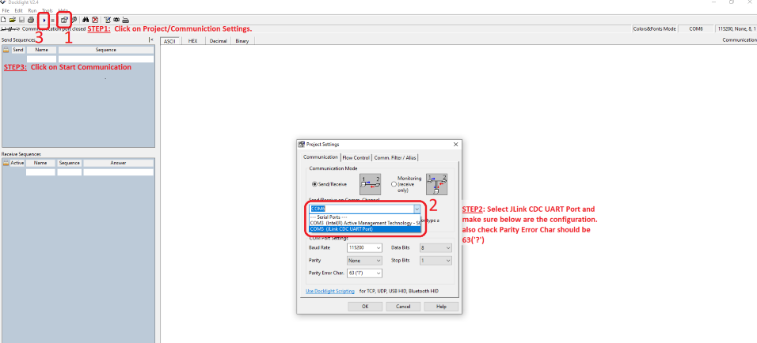
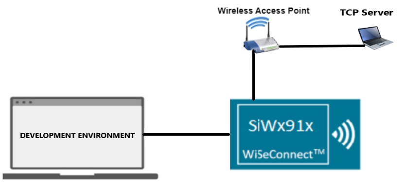
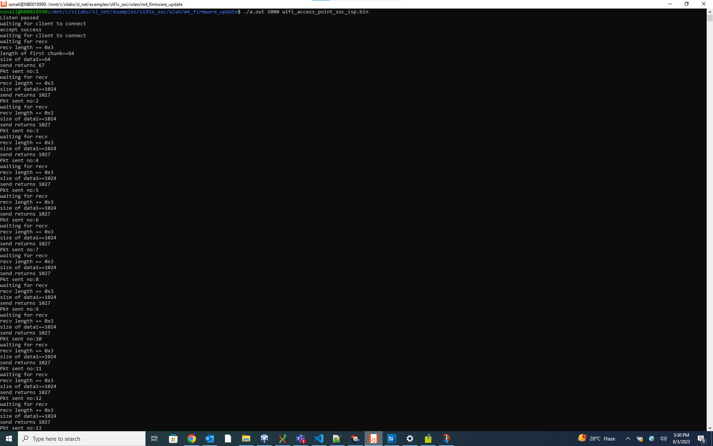
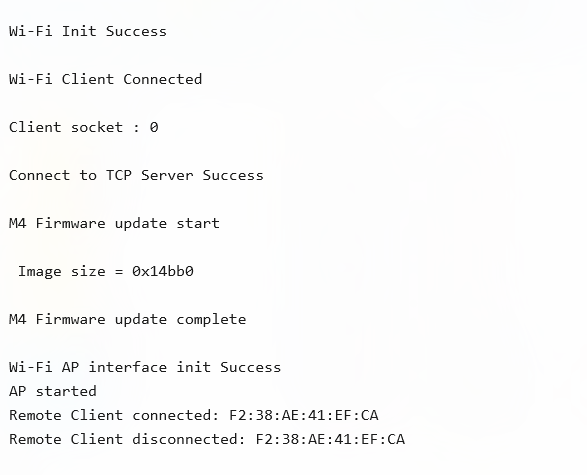

# Wi-Fi - M4 Firmware Update via TCP

## High-Level Overview

Demonstrates how to wirelessly update M4 firmware from a remote TCP server using Wi-Fi.

## Table of Contents

- [Wi-Fi - M4 Firmware Update via TCP](#wi-fi---m4-firmware-update-via-tcp)
  - [Table of Contents](#table-of-contents)
  - [High-Level Overview](#high-level-overview)
  - [Purpose/Scope](#purposescope)
  - [Prerequisites/Setup Requirements](#prerequisitessetup-requirements)
    - [Hardware Requirements](#hardware-requirements)
    - [Software Requirements](#software-requirements)
    - [Setup Diagram](#setup-diagram)
  - [Getting Started](#getting-started)
  - [Setup from Empty Project](#setup-from-empty-project)
  - [Application Build Environment](#application-build-environment)
  - [Test the Application](#test-the-application)
  - [Troubleshooting](#troubleshooting)
  - [Resources](#resources)
  - [Report Bugs and Get Support](#report-bugs-and-get-support)

## Purpose/Scope

This application shows how to update the M4 firmware of a device via Wi-Fi by downloading the firmware file from a remote TCP server. The server can be run on a local PC. Here's how the update process works:

- **Connection**: The device connects to a Wi-Fi network and acts as a TCP client.
- **Request**: The device sends a request to the TCP server for the firmware update file.
- **Download**: The server sends the firmware file to the device.
- **Update**: The device writes the new firmware to its memory and then restarts to complete the update.

This process allows the device to update its software Over-the-air (OTA) without needing a physical connection.


## Prerequisites/Setup Requirements

### Hardware Requirements  

- Windows PC
- Wireless Access Point
- Linux PC or Cygwin on Windows (to build and run the TCP server source provided)
- **SoC Mode**:
  - Standalone
    - BRD4002B Wireless Pro Kit Mainboard [SI-MB4002B](https://www.silabs.com/development-tools/wireless/wireless-pro-kit-mainboard?tab=overview)
    - Radio Boards
      - BRD4338A [SiWx917-RB4338A](https://www.silabs.com/development-tools/wireless/wi-fi/siwx917-rb4338a-wifi-6-bluetooth-le-soc-radio-board?tab=overview)
      - BRD4342A [SiWx917-RB4342A](https://www.silabs.com/development-tools/wireless/wi-fi/siwx91x-rb4342a-wifi-6-bluetooth-le-soc-radio-board?tab=overview)
      - BRD4339B [SiWx917-RB4339B](https://docs.silabs.com/wiseconnect/latest/wiseconnect-getting-started/getting-started-with-at)
      - BRD4340A [SiWx917-RB4340A](https://docs.silabs.com/wiseconnect/latest/wiseconnect-getting-started/getting-started-with-at)
      - BRD4343A [SiWx917-RB4343A](https://www.silabs.com/development-tools/wireless/wi-fi/siw917y-rb4343a-wi-fi-6-bluetooth-le-8mb-flash-radio-board-for-module?tab=overview)
      - BRD4343C [SiWx917-RB4343C](https://www.silabs.com/development-tools/wireless/wi-fi/siw917y-rb4343c-wi-fi-6-bluetooth-le-8mb-flash-radio-board-for-module?tab=overview)
  - Kits
    - SiWG917 Dev Kit [BRD2605A](https://www.silabs.com/development-tools/wireless/wi-fi/siwx917-dk2605a-wifi-6-bluetooth-le-soc-dev-kit?tab=overview)
    - SiWG917 Dev Kit [BRD2605B]
    - SiWx917 AC1 Module Explorer Kit [BRD2708A](https://www.silabs.com/development-tools/wireless/wi-fi/siw917y-ek2708a-explorer-kit?tab=overview)

### Software Requirements

- Simplicity Studio
- Linux Build Environment
  - Installation of Build tools for Linux including the gcc compiler (or equivalent on PC or Mac)
  - For Ubuntu, use the following command for installation: `user@ubuntu:~$ sudo apt install build-essential`
  - If you don't have Linux, [Cygwin for Windows](https://www.cygwin.com/) may be used instead
- VCOM Setup
  - Following are the instructions to setup the Docklight tool.

    

### Project Files

| Project | File |
|---|---|
| Wi-Fi - SoC M4 Firmware Update FreeRTOS | `wifi_soc_m4_firmware_update_freertos.slcp` |
| Wi-Fi - SoC M4 Firmware Update FreeRTOS (PSRAM) | `wifi_soc_m4_firmware_update_freertos_psram.slcp` |


### Setup Diagram



## Getting Started

Refer to the instructions [here](https://docs.silabs.com/wiseconnect/latest/wiseconnect-getting-started/) to:

- [Install Simplicity Studio](https://docs.silabs.com/wiseconnect/latest/wiseconnect-developers-guide-developing-for-silabs-hosts/#install-simplicity-studio)
- [Install WiSeConnect extension](https://docs.silabs.com/wiseconnect/latest/wiseconnect-developers-guide-developing-for-silabs-hosts/#install-the-wi-se-connect-extension)
- [Connect your device to the computer](https://docs.silabs.com/wiseconnect/latest/wiseconnect-developers-guide-developing-for-silabs-hosts/#connect-si-wx91x-to-computer)
- [Upgrade your connectivity firmware ](https://docs.silabs.com/wiseconnect/latest/wiseconnect-developers-guide-developing-for-silabs-hosts/using-the-simplicity-studio-ide#update-siwx91x-connectivity-firmware)
- [Create a Studio project ](https://docs.silabs.com/wiseconnect/latest/wiseconnect-developers-guide-developing-for-silabs-hosts/#create-a-project)

For details on the project folder structure, see the [WiSeConnect Examples](https://docs.silabs.com/wiseconnect/latest/wiseconnect-examples/#example-folder-structure) page.

## Setup from Empty Project

Use this section when building the application from a minimal/empty template so you can see which software components and configurations the feature needs. Creating the example from **Example Projects & Demos** installs these automatically.

The component and configuration list below is for the SoC project.

1. In Simplicity Studio, create a **SiWx91x Platform - Empty C FreeRTOS** project for your board (or another minimal Wi-Fi SoC empty template if available).
2. Open the project `.slcp` file, select the **Software Components** tab, and install the components below (search by label or component ID).
3. Apply the listed configurations and preprocessor defines.
4. Copy this example's `app.c` and `app.h` into the project (replace the empty-project sources).
5. Configure credentials and application parameters as described in [Application Build Environment](#application-build-environment).
6. Build, flash, and run.

### Core / RTOS

- **sl_main (System Init)** (`sl_main`)
- **FreeRTOS** (`freertos`)
- **FreeRTOS Heap 3** (`freertos_heap_3`)
- **Memory Manager** (`memory_manager`)
- **System Calls** (`syscalls`)
- **Default RAM Memory Configuration** (`si91x_memory_default_config`)

### Wi-Fi / networking

- **WiSeConnect Common Library** (`wiseconnect_common`)
- **Wi-Fi** (`wifi`)
- **Offload Network Stack** (`sl_si91x_internal_stack`)
- **WiSeConnect Resources** (`wifi_resources`)
- **Network Manager** (`network_manager`)
- **Basic Network Configuration Manager** (`basic_network_config_manager`)
- **BSD Socket** (`bsd_socket`)
- **Soft Reset** (`sl_si91x_soc_soft_reset`)

### Console / logging

- **Log - None** (`log_none`)
- **SL Log Core** (`si91x_log`)
- **Log Backend I/O Stream - Formatted Output** (`si91x_log_iostream_formatted`)
- **IO Stream** (`iostream_si91x`)
- **IO Stream Retarget STDIO** (`iostream_retarget_stdio`)
- **IO Stream UART (SiWx91x)** (`iostream_uart_si91x`), instance: `vcom`

### Required configurations

In the `.slcp` **Configuration** view (and Board Control / wakeup components where applicable), set:

- `SL_LOG_CONFIG_LEVEL_COMPILE_TIME` = `SL_LOG_CONFIG_LEVEL_INFO`
- `SL_BOARD_ENABLE_VCOM` = `1`

### Preprocessor defines

In the `.slcp` **Defines**, add:

- `SLI_SI91X_MCU_FW_UPGRADE_OTA_DUAL_FLASH`

### Feature-specific notes

- Wirelessly updates the M4 firmware from a remote TCP server

> **Tip**: Prefer creating the sample from Example Projects when you only need to run the demo. Use this empty-project path when integrating the feature into your own application.
## Application Build Environment

The application can be configured to suit your requirements and development environment.

- In the Project Explorer pane, expand the **config** folder and open the **sl_net_default_values.h** file. Configure the following parameters to enable your Silicon Labs Wi-Fi device to connect to your Wi-Fi network.

**STA instance related parameters**

- DEFAULT_WIFI_CLIENT_PROFILE_SSID refers to the name with which the Wi-Fi network shall be advertised and SiWx91x module is connected to it.

  ```c
  #define DEFAULT_WIFI_CLIENT_PROFILE_SSID               "YOUR_AP_SSID"      
  ```

- DEFAULT_WIFI_CLIENT_CREDENTIAL refers to the secret key if the access point is configured in WPA-PSK/WPA2-PSK security modes.

  ```c
  #define DEFAULT_WIFI_CLIENT_CREDENTIAL                 "YOUR_AP_PASSPHRASE" 
  ```

- DEFAULT_WIFI_CLIENT_SECURITY_TYPE refers to the security type of the access point. The supported security modes are mentioned in `sl_wifi_security_t`.

  ```c
  #define DEFAULT_WIFI_CLIENT_SECURITY_TYPE               SL_WIFI_WPA2 
  ```

- Other STA instance configurations can be modified if required in `default_wifi_client_profile` configuration structure.

**TCP Configuration**

- In the Project Explorer pane, open the **app.c** file. 

  ```c
  #define SERVER_PORT        5000             // TCP server port of the remote TCP server
  #define SERVER_IP_ADDRESS  "192.168.0.100"  // Server IP address 
  ```

> **Note**: For recommended settings, please refer the [recommendations guide](https://docs.silabs.com/wiseconnect/latest/wiseconnect-developers-guide-prog-recommended-settings/).

## Test the Application

Refer to the instructions [here](https://docs.silabs.com/wiseconnect/latest/wiseconnect-getting-started/) to:

- Build the application
- Flash, run, and debug the application

To esstablish the TCP Server with firmware file on remote PC, follow the steps below:

 1. Copy the TCP server application [firmware_update_tcp_server_9117.c](https://github.com/SiliconLabs/wiseconnect/tree/v4.2.0-content-for-docs/examples/snippets/wlan/m4_firmware_update/firmware_update_tcp_server_9117.c) provided with the application source to a Linux PC connected to the Wi-Fi access point.
  2. Compile the application.

  > `user@linux:~$ gcc firmware_update_tcp_server.c` -o ota_server.bin

  3. Run the application providing the TCP port number (specified in the SiWx91x app) together with the firmware file and path.

  > `user@linux:~$ ./ota_server.bin 5000 wifi_access_point.rps`

... where **wifi_access_point.rps** is the firmware image to be sent to SiWx91x.





  > Note:
  > Image size displayed may vary depending on the firmware provided by the server.

## Troubleshooting

If you encounter issues while running this example, check the following:

- Verify Wi-Fi credentials and TCP server IP/port match the host running the firmware server.
- Start the TCP firmware server before the SiWx91x application connects.
- Use an M4 firmware image compatible with the current NWP release.
- After the download completes, wait for flash write and reboot to complete.

## Resources

- [WiSeConnect Getting Started Guide](https://docs.silabs.com/wiseconnect/latest/wiseconnect-getting-started/)
- [WiSeConnect Examples](https://docs.silabs.com/wiseconnect/latest/wiseconnect-examples/#example-folder-structure)
- [WiSeConnect Recommended Settings Guide](https://docs.silabs.com/wiseconnect/latest/wiseconnect-developers-guide-prog-recommended-settings/)
- [Update SiWx91x Connectivity Firmware](https://docs.silabs.com/wiseconnect/latest/wiseconnect-developers-guide-developing-for-silabs-hosts/using-the-simplicity-studio-ide#update-siwx91x-connectivity-firmware)

## Report Bugs and Get Support

You are always encouraged and welcome to report any issues you found to us via [Silicon Labs Community](https://www.silabs.com/community).
