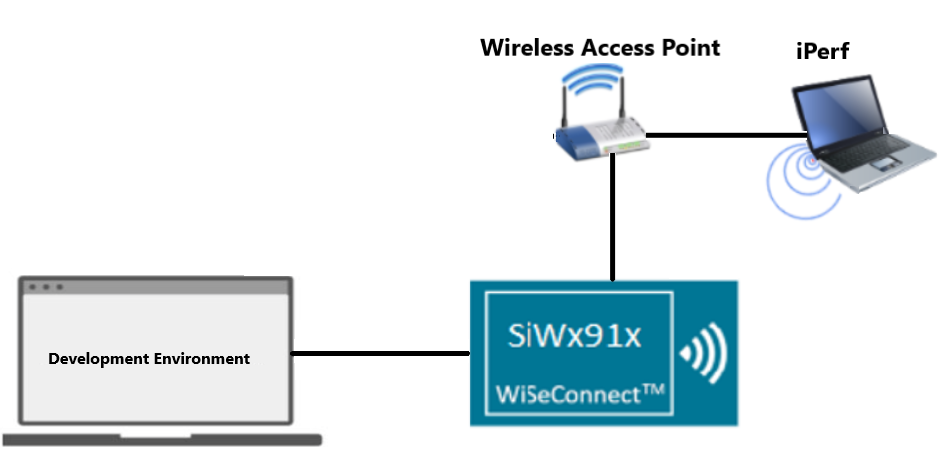
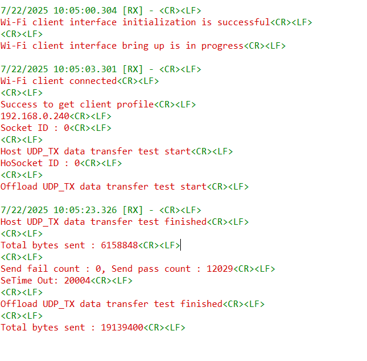
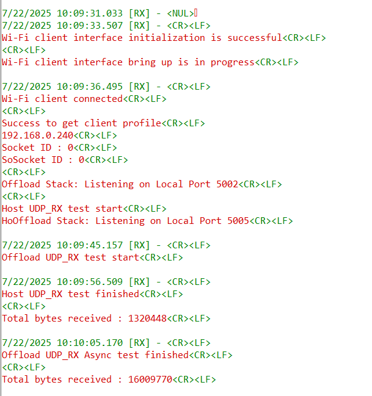
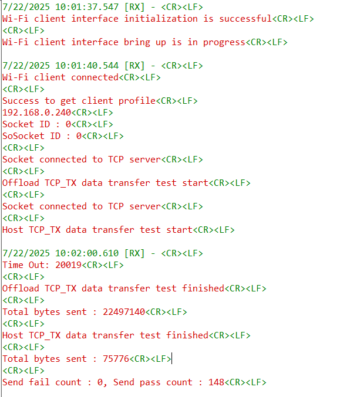
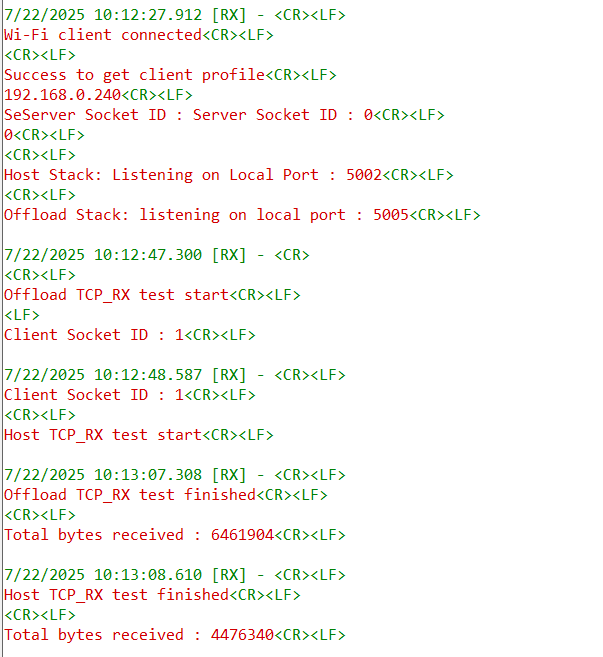

# Wi-Fi - Dual Network Stack NWP + M4

## High-Level Overview

Demonstrates how to run IPv4/IPv6 on NWP Wi-Fi offload and on M4 lwIP with TCP/UDP traffic using Wi-Fi.

## Table of Contents

- [Wi-Fi - Dual Network Stack NWP + M4](#wi-fi---dual-network-stack-nwp-+-m4)
  - [Table of Contents](#table-of-contents)
  - [High-Level Overview](#high-level-overview)
  - [Purpose/Scope](#purposescope)
  - [Prerequisites/Setup Requirements](#prerequisitessetup-requirements)
    - [Hardware Requirements](#hardware-requirements)
    - [Software Requirements](#software-requirements)
    - [Setup Diagram](#setup-diagram)
  - [Getting Started](#getting-started)
  - [Setup from Empty Project](#setup-from-empty-project)
  - [Application Build Environment](#application-build-environment)
  - [Test the application](#test-the-application)
  - [Limitations](#limitations)

  - [Troubleshooting](#troubleshooting)
  - [Resources](#resources)
  - [Report Bugs and Get Support](#report-bugs-and-get-support)

## Purpose/Scope

This application demonstrates how to configure the SiWx91x module in dual network stack mode using the **SL_SI91X_EXT_TCP_IP_DUAL_MODE_ENABLE** feature and showcases simultaneous TCP/UDP data transfer from both the NWP offload stack and the M4 host-side LwIP stack.

## Prerequisites/Setup Requirements

### Hardware Requirements

- A Windows PC.
- USB-C cable
- A Wireless Access point (which has an active internet access)

- **SoC Mode**:
  - Standalone
    - BRD4002B Wireless Pro Kit Mainboard [SI-MB4002B](https://www.silabs.com/development-tools/wireless/wireless-pro-kit-mainboard?tab=overview)
    - Radio Boards 
  	  - BRD4338A [SiWx917-RB4338A](https://www.silabs.com/development-tools/wireless/wi-fi/siwx917-rb4338a-wifi-6-bluetooth-le-soc-radio-board?tab=overview)
      - BRD4342A [SiWx917-RB4342A](https://www.silabs.com/development-tools/wireless/wi-fi/siwx91x-rb4342a-wifi-6-bluetooth-le-soc-radio-board?tab=overview)
      - BRD4339B [SiWx917-RB4339B](https://docs.silabs.com/wiseconnect/latest/wiseconnect-getting-started/getting-started-with-at)
      - BRD4340A [SiWx917-RB4340A](https://docs.silabs.com/wiseconnect/latest/wiseconnect-getting-started/getting-started-with-at)
  	  - BRD4343A [SiWx917-RB4343A](https://www.silabs.com/development-tools/wireless/wi-fi/siw917y-rb4343a-wi-fi-6-bluetooth-le-8mb-flash-radio-board-for-module?tab=overview)
  	  - BRD4343C [SiWx917-RB4343C](https://www.silabs.com/development-tools/wireless/wi-fi/siw917y-rb4343c-wi-fi-6-bluetooth-le-8mb-flash-radio-board-for-module?tab=overview)
  - Kits
  	- SiWG917 Dev Kit [BRD2605A](https://www.silabs.com/development-tools/wireless/wi-fi/siwx917-dk2605a-wifi-6-bluetooth-le-soc-dev-kit?tab=overview)
  	- SiWG917 Dev Kit [BRD2605B]
  	- SiWx917 Pro Kit [Si917-PK6031A](https://www.silabs.com/development-tools/wireless/wi-fi/siwx917-pro-kit?tab=overview)
  	- SiWx917 Pro Kit [Si917-PK6032A]
    - SiWx917 AC1 Module Explorer Kit [BRD2708A](https://www.silabs.com/development-tools/wireless/wi-fi/siw917y-ek2708a-explorer-kit?tab=overview)

- **NCP Mode** (select either the EFR32 or STM32 host MCU platform; a single platform is sufficient to run the application):
  - **Option 1: EFR32 host**
    - Standalone
      - BRD4002B Wireless Pro Kit Mainboard [SI-MB4002B](https://www.silabs.com/development-tools/wireless/wireless-pro-kit-mainboard?tab=overview)
      - EFR32xG24 Wireless 2.4 GHz +10 dBm Radio Board [xG24-RB4186C](https://www.silabs.com/development-tools/wireless/xg24-rb4186c-efr32xg24-wireless-gecko-radio-board?tab=overview)
      - NCP Expansion Kit with NCP Radio Boards
        - [BRD4346A](https://www.silabs.com/development-tools/wireless/wi-fi/siwx917-rb4346a-wifi-6-bluetooth-le-soc-4mb-flash-radio-board?tab=overview) + [BRD8045A](https://www.silabs.com/development-tools/wireless/wi-fi/expansion-adapter-board-for-co-processor-radio-boards?tab=overview)
        - [BRD4357A](https://www.silabs.com/development-tools/wireless/wi-fi/siw917y-rb4357a-wi-fi-6-bluetooth-le-4mb-flash-radio-board-for-rcp-and-ncp-modules?tab=overview) + [BRD8045A](https://www.silabs.com/development-tools/wireless/wi-fi/expansion-adapter-board-for-co-processor-radio-boards?tab=overview)
        - [BRD4357C](https://www.silabs.com/development-tools/wireless/wi-fi/siw917y-rb4357c-wi-fi-6-bluetooth-le-4mb-flash-radio-board-for-rcp-and-ncp-modules?tab=overview) + [BRD8045A](https://www.silabs.com/development-tools/wireless/wi-fi/expansion-adapter-board-for-co-processor-radio-boards?tab=overview)
    - Kits
    	- EFR32xG24 Pro Kit +10 dBm [xG24-PK6009A](https://www.silabs.com/development-tools/wireless/efr32xg24-pro-kit-10-dbm?tab=overview)

  - **Option 2: STM32F411RE host**
    - [STM32F411RE](https://www.st.com/en/microcontrollers-microprocessors/stm32f411re.html) MCU
    - NCP Expansion Kit with NCP Radio Boards
      - [BRD4346A](https://www.silabs.com/development-tools/wireless/wi-fi/siwx917-rb4346a-wifi-6-bluetooth-le-soc-4mb-flash-radio-board?tab=overview) + [BRD8045C](https://www.silabs.com/development-tools/wireless/wi-fi/shield-adapter-board-for-co-processor-radio-boards?tab=overview)
      - [BRD4357A](https://www.silabs.com/development-tools/wireless/wi-fi/siw917y-rb4357a-wi-fi-6-bluetooth-le-4mb-flash-radio-board-for-rcp-and-ncp-modules?tab=overview) + [BRD8045C](https://www.silabs.com/development-tools/wireless/wi-fi/shield-adapter-board-for-co-processor-radio-boards?tab=overview)
      - [BRD4357C](https://www.silabs.com/development-tools/wireless/wi-fi/siw917y-rb4357c-wi-fi-6-bluetooth-le-4mb-flash-radio-board-for-rcp-and-ncp-modules?tab=overview) + [BRD8045C](https://www.silabs.com/development-tools/wireless/wi-fi/shield-adapter-board-for-co-processor-radio-boards?tab=overview)

  - Interface and host MCU supported
    - SPI : EFR32 and STM32
    - UART : EFR32

### Software Requirements

- Simplicity Studio
- [Keil IDE](https://www.keil.com/) (to be used with STM32F411RE MCU)
-  Serial Terminal - [Docklight](https://docklight.de/)/[Tera Term](https://ttssh2.osdn.jp/index.html.en)

### Project Files

| Project | File |
|---|---|
| Wi-Fi - SoC Net Dual Stack NWP M4 FreeRTOS | `wifi_soc_net_dual_stack_nwp_m4_freertos.slcp` |
| Wi-Fi - Host Net Dual Stack NWP M4 FreeRTOS (SPI) | `wifi_host_net_dual_stack_nwp_m4_freertos_spi.slcp` |
| Wi-Fi - SoC Net Dual Stack NWP M4 FreeRTOS (PSRAM) | `wifi_soc_net_dual_stack_nwp_m4_freertos_psram.slcp` |

### Setup Diagram

  

## Getting Started

Refer to the instructions [here](https://docs.silabs.com/wiseconnect/latest/wiseconnect-getting-started/) to:

- [Install Simplicity Studio](https://docs.silabs.com/wiseconnect/latest/wiseconnect-developers-guide-developing-for-silabs-hosts/#install-simplicity-studio)
- [Install WiSeConnect extension](https://docs.silabs.com/wiseconnect/latest/wiseconnect-developers-guide-developing-for-silabs-hosts/#install-the-wi-se-connect-extension)
- [Connect your device to the computer](https://docs.silabs.com/wiseconnect/latest/wiseconnect-developers-guide-developing-for-silabs-hosts/#connect-si-wx91x-to-computer)
- [Upgrade your connectivity firmware](https://docs.silabs.com/wiseconnect/latest/wiseconnect-developers-guide-developing-for-silabs-hosts/#update-si-wx91x-connectivity-firmware)
- [Create a Studio project](https://docs.silabs.com/wiseconnect/latest/wiseconnect-developers-guide-developing-for-silabs-hosts/#create-a-project)

For details on the project folder structure, see the [WiSeConnect Examples](https://docs.silabs.com/wiseconnect/latest/wiseconnect-examples/#example-folder-structure) page.

## Setup from Empty Project

Use this section when building the application from a minimal/empty template so you can see which software components and configurations the feature needs. Creating the example from **Example Projects & Demos** installs these automatically.

1. In Simplicity Studio, create a **SiWx91x Platform - Empty C FreeRTOS** project for your board (or another minimal Wi-Fi SoC empty template if available).
2. Open the project `.slcp` file, select the **Software Components** tab, and install the components below (search by label or component ID).
3. Apply the listed configurations and preprocessor defines.
4. Copy this example's `app.c` and `app.h` into the project (replace the empty-project sources).
5. Configure credentials and application parameters as described in [Application Build Environment](#application-build-environment).
6. Build, flash, and run.

### Core / RTOS

- **sl_main (System Init)** (`sl_main`)
- **FreeRTOS** (`freertos`)
- **FreeRTOS Heap 3** (`freertos_heap_3`)
- **Memory Manager** (`memory_manager`)
- **System Calls** (`syscalls`)
- **Default RAM Memory Configuration** (`si91x_memory_default_config`)

### Wi-Fi / networking

- **WiSeConnect Common Library** (`wiseconnect_common`)
- **Wi-Fi** (`wifi`)
- **Dual Network Stack** (`sl_si91x_network_dual_stack`)
- **WiSeConnect Resources** (`wifi_resources`)
- **Network Manager** (`network_manager`)
- **Basic Network Configuration Manager** (`basic_network_config_manager`)
- **SiWx91x Asynchronous Socket** (`sl_si91x_asynchronous_socket`)

### Console / logging

- **Log - None** (`log_none`)
- **SL Log Core** (`si91x_log`)
- **Log Backend I/O Stream - Formatted Output** (`si91x_log_iostream_formatted`)
- **IO Stream** (`iostream_si91x`)
- **IO Stream Retarget STDIO** (`iostream_retarget_stdio`)
- **IO Stream UART (SiWx91x)** (`iostream_uart_si91x`), instance: `vcom`

### Required configurations

In the `.slcp` **Configuration** view (and Board Control / wakeup components where applicable), set:

- `SL_LOG_CONFIG_LEVEL_COMPILE_TIME` = `SL_LOG_CONFIG_LEVEL_INFO`
- `SL_BOARD_ENABLE_VCOM` = `1`

### Preprocessor defines

In the `.slcp` **Defines**, add:

- `SLI_SI91X_ENABLE_IPV6`
- `LWIP_IPV6` = `1`

### Feature-specific notes

- Install **Dual Network Stack** (not Offload-only or LwIP-only).
- Also install **SiWx91x Asynchronous Socket**.

> **Tip**: Prefer creating the sample from Example Projects when you only need to run the demo. Use this empty-project path when integrating the feature into your own application.

## Application Build Environment

- The application can be configured to suit your requirements and development environment. Read through the following sections and make any changes as needed.

- In the Project Explorer pane, expand the **config/** folder and open the ``sl_net_default_values.h`` file. Configure the following parameters to enable your Silicon Labs Wi-Fi device to connect to your Wi-Fi network.

- STA instance related parameters

  - DEFAULT_WIFI_CLIENT_PROFILE_SSID refers to the name with which Wi-Fi network that shall be advertised and SiWx91x module is connected to it.
  
     ```c
     #define DEFAULT_WIFI_CLIENT_PROFILE_SSID               "YOUR_AP_SSID"      
     ```

  - DEFAULT_WIFI_CLIENT_CREDENTIAL refers to the secret key if the Access point is configured in WPA-PSK/WPA2-PSK security modes.

     ```c
     #define DEFAULT_WIFI_CLIENT_CREDENTIAL                 "YOUR_AP_PASSPHRASE" 
     ```

  - DEFAULT_WIFI_CLIENT_SECURITY_TYPE refers to the security type if the Access point is configured in WPA/WPA2 or mixed security modes.

    ```c
    #define DEFAULT_WIFI_CLIENT_SECURITY_TYPE                 SL_WIFI_WPA2
    ```
  
  - Other STA instance configurations can be modified if required in `client_configuration` configuration structure defined in app.c.

- Configure the following parameters in ``app.c`` to test dual stack data transfer application.

  - The application may be configured to run TCP/UDP Tx or RX traffic from both NWP and LwIP stacks simultanuously. The default option runs traffic only from offload stack. Configure `HOST_DATA_TRANSFER` to 1 to enable host data transfer.

  - **Data Transfer Mode Configuration**

      ```c
      #define HOST_DATA_TRANSFER        0    // 1 - Enable host stack data transfer, 0 - Disable host stack data transfer
      #define TCP_MODE                  0    // 1 - TCP socket operations, 0 - UDP socket operations  
      #define TX_MODE                   0    // 1 - Transmit mode, 0 - Receive mode
      ```

  - **Socket Configuration**

      ```c
      #define LISTENING_PORT            5005 // Offload stack listening port
      #define SERVER_PORT               5004 // Offload stack server port
      #define HOST_LISTENING_PORT       5002 // Host stack listening port  
      #define HOST_SERVER_PORT          5001 // Host stack server port
      ```

  - **Remote Server Configuration**

      ```c
      #define SERVER_IP                 "192.168.0.206"  // Remote server IPv4 address
      ```

  - **Data Transfer Parameters**

      ```c
      #define BUFFER_SIZE               512   // Data buffer size for host stack
      #define TCP_BUFFER_SIZE           1460  // TCP buffer size for offload stack
      #define BYTES_TO_SEND             (1 << 29)  // Total bytes to send (512MB)
      #define BYTES_TO_RECEIVE          (1 << 28)  // Total bytes to receive (256MB)
      #define TEST_TIMEOUT              20000      // Test timeout in milliseconds
      ```

> **Note**: For recommended settings, please refer the [recommendations guide](https://docs.silabs.com/wiseconnect/latest/wiseconnect-developers-guide-prog-recommended-settings/).

## Test the application

Refer to the instructions [here](https://docs.silabs.com/wiseconnect/latest/wiseconnect-getting-started/) to:

- Build the application.

- Flash, run and debug the application.

### To Run Traffic

#### UDP Tx Traffic

To run UDP Tx traffic, configure the SiWx91x as a UDP client and start UDP servers on the remote PC. Open the [iPerf Application](https://sourceforge.net/projects/iperf2/files/iperf-2.0.8-win.zip/download) and run the following commands from the installed folder's path in the command prompt to start two UDP servers on different ports:

The iPerf command to start the UDP server on the PC is:

> `C:\> iperf.exe -s -u -p <SERVER_PORT> -i 1`

For example:

> `C:\> iperf.exe -s -u -p 5001 -i 1`
> `C:\> iperf.exe -s -u -p 5002 -i 1`

This allows simultaneous UDP traffic testing on both ports.



#### UDP Rx Traffic

To run UDP Rx traffic, configure the SiWx91x as a UDP server and start UDP clients on the remote PC using two command prompts.  
Open two command prompts in the iPerf installed folder and run the following commands to start UDP clients on different ports:

  > `C:\> iperf.exe -c <Module_IP> -u -p <LISTENING_PORT>> -i 1 -b <Bandwidth> -t <time interval in seconds>`

For example:

  > `C:\> iperf.exe -c 192.168.0.100 -u -p 5001 -i 1 -b 70M -t 30`
  > 
  > `C:\> iperf.exe -c 192.168.0.100 -u -p 5002 -i 1 -b 70M -t 30`

This will send UDP traffic to the SiWx91x module on both ports for simultaneous receive testing.

  

#### TCP Tx Traffic

To run TCP Tx traffic, configure the SiWx91x as a TCP client and start TCP servers on the remote PC using two command prompts. Open the [iPerf Application](https://sourceforge.net/projects/iperf2/files/iperf-2.0.8-win.zip/download) and run the following commands from the installed folder's path in two separate command prompts to start TCP servers on different ports:

The iPerf command to start the TCP server is:

> `C:\> iperf.exe -s -p <SERVER_PORT> -i 1 -S 0xC8`

For example:

> `C:\> iperf.exe -s -p 5001 -i 1 -S 0xC8`
>
> `C:\> iperf.exe -s -p 5002 -i 1 -S 0xC8`

This allows simultaneous TCP traffic testing on both ports.

  

#### TCP Rx Traffic

To run TCP Rx traffic, configure the SiWx91x as a TCP server and start TCP clients on the remote PC using two command prompts. Open two command prompts in the iPerf installed folder and run the following commands to start TCP clients on different ports:

The iPerf command to start the TCP client is:

  > `C:\> iperf.exe -c <Module_IP> -p <LISTENING_PORT> -i 1 -t <time interval in sec> -S 0xC8`

For example:

  > `C:\> iperf.exe -c 192.168.0.100 -p 5001 -i 1 -t 30 -S 0xC8`
  >
  > `C:\> iperf.exe -c 192.168.0.100 -p 5002 -i 1 -t 30 -S 0xC8`

This will send TCP traffic to the SiWx91x module on both ports for simultaneous receive testing. 

  


## Limitations

- IPv6 is not supported in dual network stack mode.

- Triggering DHCP process from external host is currently not supported.

## Troubleshooting

If you encounter issues while running this example, check the following:

- Verify Wi-Fi credentials in `sl_net_default_values.h` and enable `SL_SI91X_EXT_TCP_IP_DUAL_MODE_ENABLE` in your project configuration.
- Configure socket IP/port settings for both NWP and M4 LwIP paths in `app.c`.
- Start remote servers before the DUT connects on either stack.
- Review [Limitations](#limitations) for supported feature combinations.

## Resources

- [WiSeConnect Getting Started Guide](https://docs.silabs.com/wiseconnect/latest/wiseconnect-getting-started/)
- [WiSeConnect Examples](https://docs.silabs.com/wiseconnect/latest/wiseconnect-examples/#example-folder-structure)
- [WiSeConnect Recommended Settings Guide](https://docs.silabs.com/wiseconnect/latest/wiseconnect-developers-guide-prog-recommended-settings/)

## Report Bugs and Get Support

You are always encouraged and welcome to report any issues you found to us via [Silicon Labs Community](https://www.silabs.com/community).
