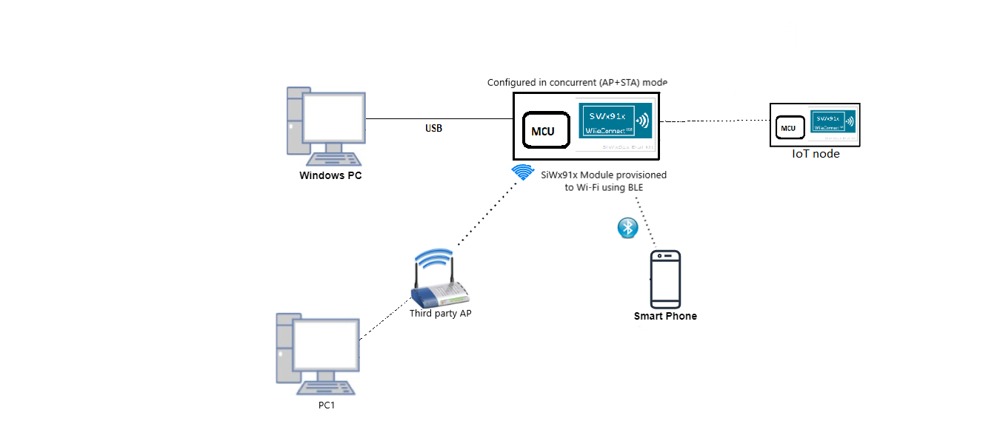
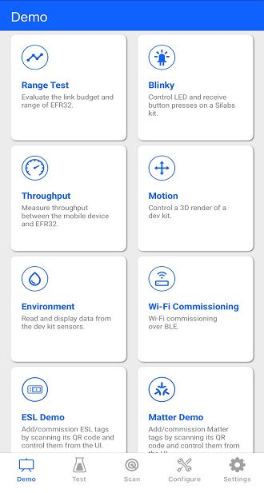
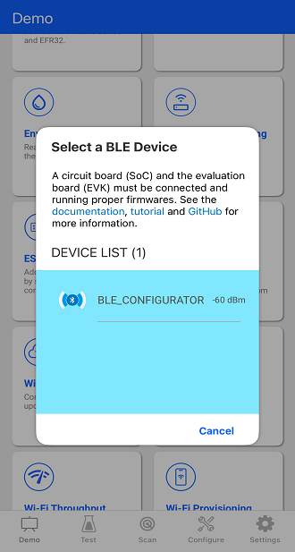
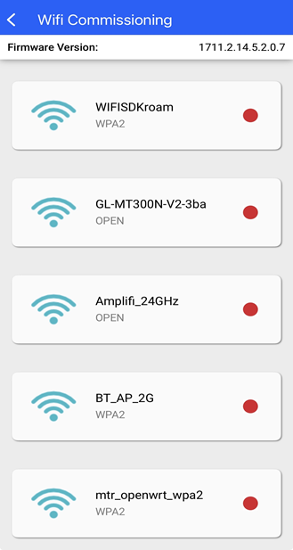
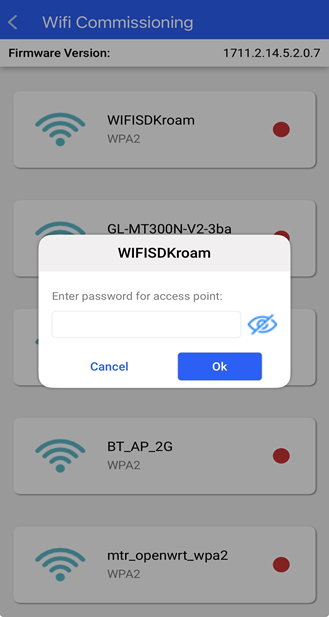
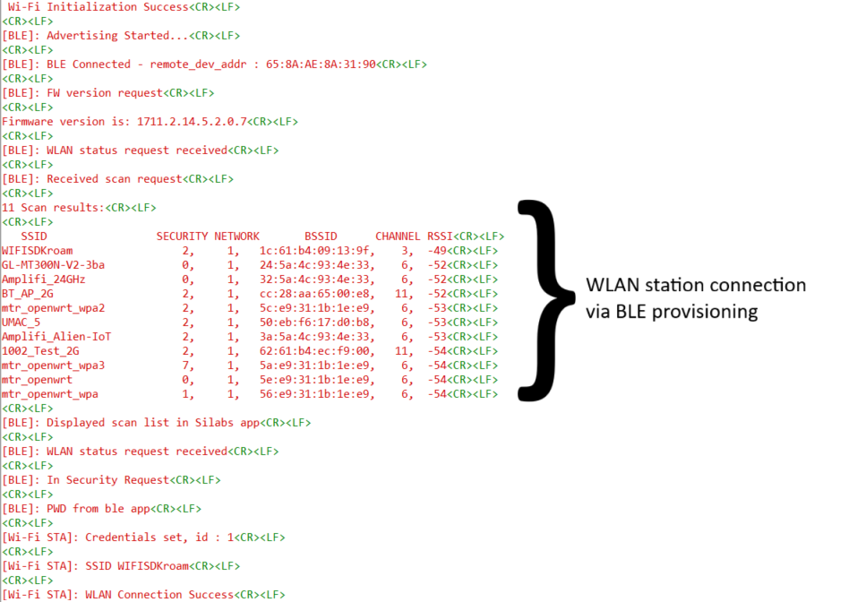
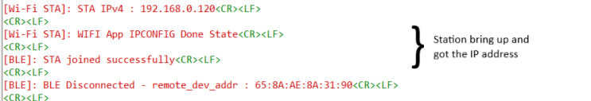
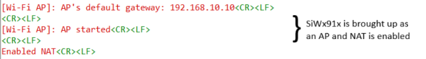
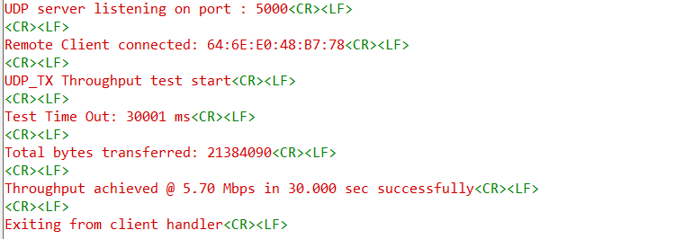
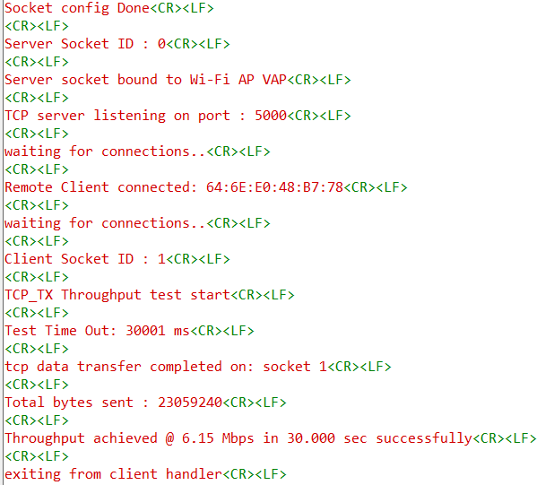

# Wi-Fi Bluetooth LE - Concurrent NAT BLE Provisioning

## High-Level Overview

Demonstrates how to enable concurrent AP+STA with NAT so third-party clients reach the internet using Wi-Fi and Bluetooth LE.

## Table of Contents

- [Wi-Fi Bluetooth LE - Concurrent NAT BLE Provisioning](#wi-fi-bluetooth-le-concurrent-nat-ble-provisioning)
  - [Table of Contents](#table-of-contents)
  - [High-Level Overview](#high-level-overview)
  - [Purpose / Scope](#purpose--scope)
  - [Prerequisites / Setup Requirements](#prerequisites--setup-requirements)
    - [Hardware Requirements](#hardware-requirements)
    - [Software Requirements](#software-requirements)
    - [Setup Diagram](#setup-diagram)
  - [Getting Started](#getting-started)
  - [Setup from Empty Project](#setup-from-empty-project)
  - [Application Build Environment](#application-build-environment)
  - [Test the Application](#test-the-application)
  - [Troubleshooting](#troubleshooting)
  - [Resources](#resources)
  - [Report Bugs and Get Support](#report-bugs-and-get-support)

## Purpose / Scope

This application brings up the SiWx91x device as a station using BLE provisioning. Once connected, the SiWx91x device also enables the AP interface and operates in concurrent mode. After that, the Network Address Translation (NAT) feature is activated, allowing third-party Wi-Fi clients connected to the SiWx91x device Access Point (AP) to access the internet through a third-party AP via NAT.

## Prerequisites / Setup Requirements

### Hardware Requirements

- Windows PC
- SiWx91x device
- **SoC Mode**:
  - Standalone
    - BRD4002B Wireless Pro Kit Mainboard [SI-MB4002B](https://www.silabs.com/development-tools/wireless/wireless-pro-kit-mainboard?tab=overview)
    - Radio Boards 
  	  - BRD4338A [SiWx917-RB4338A](https://www.silabs.com/development-tools/wireless/wi-fi/siwx917-rb4338a-wifi-6-bluetooth-le-soc-radio-board?tab=overview)
      - BRD4342A [SiWx91x-RB4342A](https://www.silabs.com/development-tools/wireless/wi-fi/siwx91x-rb4342a-wifi-6-bluetooth-le-soc-radio-board?tab=overview)
      - BRD4339B [SiWx917-RB4339B](https://docs.silabs.com/wiseconnect/latest/wiseconnect-getting-started/getting-started-with-at)
      - BRD4340A [SiWx917-RB4340A](https://docs.silabs.com/wiseconnect/latest/wiseconnect-getting-started/getting-started-with-at)
  	  - BRD4343A [SiWx917-RB4343A](https://www.silabs.com/development-tools/wireless/wi-fi/siw917y-rb4343a-wi-fi-6-bluetooth-le-8mb-flash-radio-board-for-module?tab=overview)
  	  - BRD4343C [SiWx917-RB4343C](https://www.silabs.com/development-tools/wireless/wi-fi/siw917y-rb4343c-wi-fi-6-bluetooth-le-8mb-flash-radio-board-for-module?tab=overview)
  - Kits
  	- SiWG917 Dev Kit [BRD2605A](https://www.silabs.com/development-tools/wireless/wi-fi/siwx917-dk2605a-wifi-6-bluetooth-le-soc-dev-kit?tab=overview)
  	- SiWG917 Dev Kit [BRD2605B]
  	- SiWx917 Pro Kit [SiWx917-PK6031A](https://www.silabs.com/development-tools/wireless/wi-fi/siwx917-pro-kit?tab=overview)
  	
- **NCP Mode** (select either the EFR32 or STM32 host MCU platform; a single platform is sufficient to run the application):
  - **Option 1: EFR32 host**
    - Standalone
      - BRD4002B Wireless Pro Kit Mainboard [SI-MB4002B](https://www.silabs.com/development-tools/wireless/wireless-pro-kit-mainboard?tab=overview)
      - EFR32xG24 Wireless 2.4 GHz +10 dBm Radio Board [xG24-RB4186C](https://www.silabs.com/development-tools/wireless/xg24-rb4186c-efr32xg24-wireless-gecko-radio-board?tab=overview)
      - NCP Expansion Kit with NCP Radio Boards
        - [BRD4346A](https://www.silabs.com/development-tools/wireless/wi-fi/siwx917-rb4346a-wifi-6-bluetooth-le-soc-4mb-flash-radio-board?tab=overview) + [BRD8045A](https://www.silabs.com/development-tools/wireless/wi-fi/expansion-adapter-board-for-co-processor-radio-boards?tab=overview)
        - [BRD4357A](https://www.silabs.com/development-tools/wireless/wi-fi/siw917y-rb4357a-wi-fi-6-bluetooth-le-4mb-flash-radio-board-for-rcp-and-ncp-modules?tab=overview) + [BRD8045A](https://www.silabs.com/development-tools/wireless/wi-fi/expansion-adapter-board-for-co-processor-radio-boards?tab=overview)
        - [BRD4357C](https://www.silabs.com/development-tools/wireless/wi-fi/siw917y-rb4357c-wi-fi-6-bluetooth-le-4mb-flash-radio-board-for-rcp-and-ncp-modules?tab=overview) + [BRD8045A](https://www.silabs.com/development-tools/wireless/wi-fi/expansion-adapter-board-for-co-processor-radio-boards?tab=overview)
    - Kits
    	- EFR32xG24 Pro Kit +10 dBm [xG24-PK6009A](https://www.silabs.com/development-tools/wireless/efr32xg24-pro-kit-10-dbm?tab=overview)

  - **Option 2: STM32F411RE host**
    - [STM32F411RE](https://www.st.com/en/microcontrollers-microprocessors/stm32f411re.html) MCU
    - NCP Expansion Kit with NCP Radio Boards
      - [BRD4346A](https://www.silabs.com/development-tools/wireless/wi-fi/siwx917-rb4346a-wifi-6-bluetooth-le-soc-4mb-flash-radio-board?tab=overview) + [BRD8045C](https://www.silabs.com/development-tools/wireless/wi-fi/shield-adapter-board-for-co-processor-radio-boards?tab=overview)
      - [BRD4357A](https://www.silabs.com/development-tools/wireless/wi-fi/siw917y-rb4357a-wi-fi-6-bluetooth-le-4mb-flash-radio-board-for-rcp-and-ncp-modules?tab=overview) + [BRD8045C](https://www.silabs.com/development-tools/wireless/wi-fi/shield-adapter-board-for-co-processor-radio-boards?tab=overview)
      - [BRD4357C](https://www.silabs.com/development-tools/wireless/wi-fi/siw917y-rb4357c-wi-fi-6-bluetooth-le-4mb-flash-radio-board-for-rcp-and-ncp-modules?tab=overview) + [BRD8045C](https://www.silabs.com/development-tools/wireless/wi-fi/shield-adapter-board-for-co-processor-radio-boards?tab=overview)

  - Interface and host MCU supported
     - SPI : EFR32 and STM32
    - UART : EFR32
- Wireless Access point
- Android Phone or iPhone with **Simplicity Connect App(formerly EFR Connect App)** App, which is available in Play Store and App Store.
- Windows PC with windows Silicon labs connect application.

### Software Requirements

- Simplicity Studio IDE - [Simplicity Studio IDE](https://www.silabs.com/developer-tools/simplicity-studio) (to be used with Silicon Labs MCU)
- [Keil IDE](https://www.keil.com/) (to be used with STM32F411RE MCU)
- Download and install the Silicon Labs [Simplicity Connect App (formerly EFR Connect App)](https://www.silabs.com/developers/simplicity-connect-mobile-app ) from Play store/App store.


### Project Files

| Project | File |
|---|---|
| Wi-Fi Bluetooth LE - Host Concurrent NAT BLE Provisioning FreeRTOS (SPI) | `wifi_ble_host_concurrent_nat_ble_provisioning_freertos_spi.slcp` |
| Wi-Fi Bluetooth LE - SoC Concurrent NAT BLE Provisioning FreeRTOS | `wifi_ble_soc_concurrent_nat_ble_provisioning_freertos.slcp` |

### Setup Diagram

  


## Getting Started

Refer to the instructions [here](https://docs.silabs.com/wiseconnect/latest/wiseconnect-getting-started/) to:

- [Install Simplicity Studio](https://docs.silabs.com/wiseconnect/latest/wiseconnect-developers-guide-developing-for-silabs-hosts/using-the-simplicity-studio-ide/#install-simplicity-studio)
- [Install WiSeConnect extension](https://docs.silabs.com/wiseconnect/latest/wiseconnect-developers-guide-developing-for-silabs-hosts/using-the-simplicity-studio-ide/#install-the-wiseconnect-3-extension) 
- [Connect your device to the computer](https://docs.silabs.com/wiseconnect/latest/wiseconnect-developers-guide-developing-for-silabs-hosts/using-the-simplicity-studio-ide#connect-siwx91x-to-computer)
- [Upgrade your connectivity firmware](https://docs.silabs.com/wiseconnect/latest/wiseconnect-developers-guide-developing-for-silabs-hosts/using-the-simplicity-studio-ide#update-siwx91x-connectivity-firmware)
- [Create a Studio project](https://docs.silabs.com/wiseconnect/latest/wiseconnect-developers-guide-developing-for-silabs-hosts/using-the-simplicity-studio-ide#create-a-project)

For details on the project folder structure, see the [WiSeConnect Examples](https://docs.silabs.com/wiseconnect/latest/wiseconnect-examples/#example-folder-structure) page.

## Setup from Empty Project

Use this section when building the application from a minimal/empty template so you can see which software components and configurations the feature needs. Creating the example from **Example Projects & Demos** installs these automatically.

The component and configuration list below is for the SoC project.

1. In Simplicity Studio, create a **SiWx91x Platform - Empty C FreeRTOS** project for your board (or another minimal Wi-Fi SoC empty template if available).
2. Open the project `.slcp` file, select the **Software Components** tab, and install the components below (search by label or component ID).
3. Apply the listed configurations.
4. Copy this example's `app.c` and `app.h` into the project (replace the empty-project sources).
5. Configure credentials and application parameters as described in [Application Build Environment](#application-build-environment).
6. Build, flash, and run.

### Core / RTOS

- **sl_main (System Init)** (`sl_main`)
- **FreeRTOS** (`freertos`)
- **FreeRTOS Heap 3** (`freertos_heap_3`)
- **Memory Manager** (`memory_manager`)
- **System Calls** (`syscalls`)
- **Default RAM Memory Configuration** (`si91x_memory_default_config`)

### Wi-Fi / networking

- **WiSeConnect Common Library** (`wiseconnect_common`)
- **BLE** (`ble`)
- **Wi-Fi** (`wifi`)
- **Offload Network Stack** (`sl_si91x_internal_stack`)
- **WiSeConnect Resources** (`wifi_resources`)
- **Network Manager** (`network_manager`)
- **Basic Network Configuration Manager** (`basic_network_config_manager`)
- **BSD Socket** (`bsd_socket`)
- **SiWx91x Asynchronous Socket** (`sl_si91x_asynchronous_socket`)

### Console / logging

- **Log - None** (`log_none`)
- **SL Log Core** (`si91x_log`)
- **Log Backend I/O Stream - Formatted Output** (`si91x_log_iostream_formatted`)
- **IO Stream** (`iostream_si91x`)
- **IO Stream Retarget STDIO** (`iostream_retarget_stdio`)
- **IO Stream UART (SiWx91x)** (`iostream_uart_si91x`), instance: `vcom`

### Required configurations

In the `.slcp` **Configuration** view (and Board Control / wakeup components where applicable), set:

- `SL_LOG_CONFIG_LEVEL_COMPILE_TIME` = `SL_LOG_CONFIG_LEVEL_INFO`
- `SL_BOARD_ENABLE_VCOM` = `1`

### Feature-specific notes

- This application demonstrates how to enable AP+STA interfaces in concurrent mode and how third-party Wi-Fi clients connected to the SiWG917 can access the internet through a third-party AP using NAT.

> **Tip**: Prefer creating the sample from Example Projects when you only need to run the demo. Use this empty-project path when integrating the feature into your own application.
## Application Build Environment

The application can be configured to suit your requirements and development environment. Read through the following sections and make any changes needed.

> **Note:** The `ble_config.h` file is already configured with the desired settings for this example.

  `RSI_BLE_APP_DEVICE_NAME` refers to the name of the SiWx91x device to appear during scanning by remote devices.

  ```c
  #define RSI_BLE_APP_DEVICE_NAME        "BLE_CONFIGURATOR"
  ```

  **Configure the Wi-Fi parameters**

- In the Project Explorer pane, open the `wifi_config.h` file and update/modify following macros:

  - Enter the third-party AP Connectivity essentials configurations as the value to SSID and PSK.
      ```c
      #define WIFI_AP_PROFILE_SSID     "MY_DUAL_AP_SSID"
      #define WIFI_AP_CREDENTIAL       "MY_AP_PASSPHRASE"
      ```
- To operate in AP-only mode, enable the `AP_ONLY_MODE` macro.

> **Note:** The NAT feature is supported only when the device operates in concurrent AP+STA mode.

> **Note:** Users can configure default region-specific regulatory information using `sl_wifi_region_db_config.h`

## Test the Application

Refer to the instructions [here](https://docs.silabs.com/wiseconnect/latest/wiseconnect-getting-started/) to:

- Build the application.
- Flash, run and debug the application.


###  Steps to verify the Wi-Fi Concurrent NAT with BLE Provisioning Example

 Steps to be followed to verify WLAN Station BLE Provisioning with Android/iOS **Simplicity Connect App(formerly EFR Connect App)** App
 > **Note:** Version 2.9.0 or above

1. Configure the third-party AP in OPEN, WPA-PSK, WPA2-PSK, or WPA3 mode for the SiWx91x device to connect.

2. Connect any serial console for prints.

3. The SiWx91x device enters into the BLE advertising mode, launch the **Simplicity Connect App(formerly EFR Connect App)** App.

4. Click on the **Demo** tab and select **Wi-Fi Commissioning** tile.

    

5. The SiWx91x device advertises as the "BLE_CONFIGURATOR". Click on "BLE_CONFIGURATOR" to initiate the connection from the mobile app.

    

6. Once the BLE connection is successfully established, the SiWx917 initiates a WLAN scan to detect available access points in the vicinity and forwards the scan results to the Si Connect app via BLE.

7. Select the third-party AP from the scanned list as shown below.

    

8. If the selected third-party AP is configured in the security, the password entry pop-up window will be appeared.

9. Enter the password and click on "CONNECT".

    

10. Once the SiWx91x device gets connected to the third-party AP, IP address of SiWx91x device get displayed on the screen.

    

    
11. After STA IP configuration completes, the application automatically disconnects the BLE link from the provisioner.

12. SiWx91x device brings up the AP interface and starts operating concurrently and then NAT is enabled.

    

13. Client devices can then connect to the SiWx91x device AP and get internet access via a third-party AP.

###  Throughput testing

**UDP Tx Throughput**

1. Set the following macro in `wifi_config.h`:
   ```c
      #define THROUGHPUT_TYPE       UDP_TX
   ```
2. Compile and flash the application.

3. Once connected to the SiWx91x device AP, navigate to **`/<SDK>/resources/scripts/`**. Run the **udp_client.py** script on port number 5000 using the following command:

   `python.exe .\udp_client.py 192.168.10.10 5000`

   


**TCP Tx Throughput**

1. Set the following macro in `wifi_config.h`:
   ```c
      #define THROUGHPUT_TYPE       TCP_TX
   ```
2. Compile and flash the application.

3. Once connected to the SiWx91x device AP, navigate to **`/<SDK>/resources/scripts/`**. Run the **tcp_client.py** script on port number 5000 using the following command:

   `python.exe .\tcp_client.py 192.168.10.10 5000`

   

   **NOTE:** If the python command is not working, replace the python with py.


> **Note** : The number of NAT entries is limited to 100.

## Troubleshooting

If you encounter issues while running this example, check the following:

- Complete BLE provisioning before you expect STA and concurrent AP interfaces to come up.
- Verify third-party AP credentials received during BLE provisioning are correct.
- Ensure NAT client devices connect to the SiWx91x SoftAP, not the upstream AP directly.
- The NAT entry limit is 100. If NAT forwarding fails, reduce the number of connected clients.

## Resources

- [WiSeConnect Getting Started Guide](https://docs.silabs.com/wiseconnect/latest/wiseconnect-getting-started/)
- [WiSeConnect Examples](https://docs.silabs.com/wiseconnect/latest/wiseconnect-examples/#example-folder-structure)
- [WiSeConnect Recommended Settings Guide](https://docs.silabs.com/wiseconnect/latest/wiseconnect-developers-guide-prog-recommended-settings/)

## Report Bugs and Get Support

You are always encouraged and welcome to report any issues you found to us via [Silicon Labs Community](https://www.silabs.com/community).
