# Wi-Fi Bluetooth LE - Out of Box Demo

## High-Level Overview

Demonstrates how to explore Wi-Fi, Bluetooth LE, MCU peripherals, and NWP power save out of the box using Wi-Fi and Bluetooth LE.

## Table of Contents

- [Wi-Fi Bluetooth LE - Out of Box Demo](#wi-fi-bluetooth-le-out-of-box-demo)
  - [Table of Contents](#table-of-contents)
  - [High-Level Overview](#high-level-overview)
  - [Purpose/Scope](#purposescope)
  - [Prerequisites/Setup Requirements](#prerequisitessetup-requirements)
    - [Hardware Requirements](#hardware-requirements)
    - [Software Requirements](#software-requirements)
    - [Setup Diagram](#setup-diagram)
  - [Upgrade application binary](#upgrade-application-binary)
  - [Setup from Empty Project](#setup-from-empty-project)
  - [Application build environment](#application-build-environment)
  - [Test the Application](#test-the-application)
    - [Application display](#application-display)
    - [Run the application](#run-the-application)
    - [Update MQTT Hostname in wifi\_app.c](#update-mqtt-hostname-in-wifi_appc)
    - [Measuring the current consumption using Simplicity Studio Energy Profiler](#measuring-the-current-consumption-using-simplicity-studio-energy-profiler)

  - [Troubleshooting](#troubleshooting)
  - [Resources](#resources)
  - [Report Bugs and Get Support](#report-bugs-and-get-support)

## Purpose/Scope

The demo works with both the Wireless Pro Kit (WPK) and the SiWG917 dev kit. If the pro kit is used, the demo displays its status on the TFT-LCD display of the WPK baseboard. 
The SiWG917 dev kit does not have an onboard display. All device activities for the pro and dev kits can be observed on the serial terminal prints. 

SiWG917 establishes WLAN connectivity via BLE provisioning. SiWG917 then proceeds to ping [www.silabs.com](https://www.silabs.com) for 5 times, after which MQTT connectivity with a remote mosquitto broker [test.mosquitto.org](http://test.mosquitto.org) is established.
Then Network processor of SiWG917 enters connected sleep state.

If an MQTT client publishes a message to a topic that the module subscribes to (Si917_MQTT_RECEIVE), the network processor (NWP) wakes up, displays the received data, and then returns to sleep.

When BTN0 is pressed on the WPK baseboard or development kit, SiWG917 publishes a message to the Si917_APP_STATUS MQTT topic. The application status is updated on the TFT-LCD display on the WPK baseboard. You can also view the status in the serial terminal output.

## Prerequisites/Setup Requirements

- Before running the application, the user will need the following things to setup.

### Hardware Requirements

- Windows PC
- A Wireless Access point with internet connectivity
- **SoC Mode**:
  - Standalone
    - BRD4002B Wireless Pro Kit Mainboard [SI-MB4002B](https://www.silabs.com/development-tools/wireless/wireless-pro-kit-mainboard?tab=overview)
    - Radio Boards
      - BRD4338A [SiWx917-RB4338A](https://www.silabs.com/development-tools/wireless/wi-fi/siwx917-rb4338a-wifi-6-bluetooth-le-soc-radio-board?tab=overview)
      - BRD4342A [SiWx917-RB4342A](https://www.silabs.com/development-tools/wireless/wi-fi/siwx91x-rb4342a-wifi-6-bluetooth-le-soc-radio-board?tab=overview)
      - BRD4339B [SiWx917-RB4339B](https://docs.silabs.com/wiseconnect/latest/wiseconnect-getting-started/getting-started-with-at)
      - BRD4340A [SiWx917-RB4340A](https://docs.silabs.com/wiseconnect/latest/wiseconnect-getting-started/getting-started-with-at)
      - BRD4343A [SiWx917-RB4343A](https://www.silabs.com/development-tools/wireless/wi-fi/siw917y-rb4343a-wi-fi-6-bluetooth-le-8mb-flash-radio-board-for-module?tab=overview)
      - BRD4343C [SiWx917-RB4343C](https://www.silabs.com/development-tools/wireless/wi-fi/siw917y-rb4343c-wi-fi-6-bluetooth-le-8mb-flash-radio-board-for-module?tab=overview)
  - Kits
    - SiWG917 Dev Kit [BRD2605A](https://www.silabs.com/development-tools/wireless/wi-fi/siwx917-dk2605a-wifi-6-bluetooth-le-soc-dev-kit?tab=overview)
    - SiWx917 Pro Kit [Si917-PK6031A](https://www.silabs.com/development-tools/wireless/wi-fi/siwx917-pro-kit?tab=overview)
- Android Phone or iPhone with Simplicity Connect App (formerly EFR Connect App), which is available in Play Store and App Store (or) Windows PC with windows Silicon labs connect application.

### Software Requirements

- [Simplicity Studio](https://www.silabs.com/developers/simplicity-studio)
- Silicon Labs [Simplicity Connect App (formerly EFR Connect App)](https://www.silabs.com/developers/simplicity-connect-mobile-app?tab=downloads), the app can be downloaded from Google Play store/Apple App store.


### Project Files

| Project | File |
|---|---|
| Wi-Fi Bluetooth LE - SoC Out of Box Demo FreeRTOS (PSRAM) | `wifi_ble_soc_out_of_box_demo_freertos_psram.slcp` |
| Wi-Fi Bluetooth LE - SoC Out of Box Demo FreeRTOS | `wifi_ble_soc_out_of_box_demo_freertos.slcp` |

### Setup Diagram

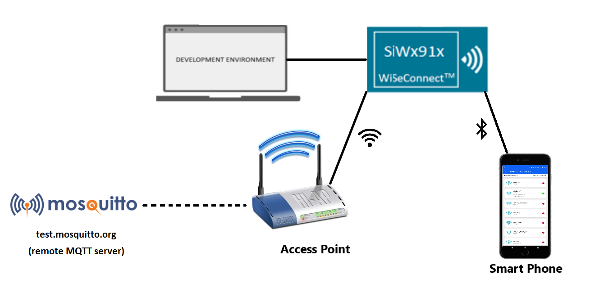

## Upgrade application binary

- Download the latest out-of-box demo binary from [the WiseConnect SDK GitHub repository](https://github.com/SiliconLabs/wiseconnect/tree/v4.2.0-content-for-docs/demos).

- Follow the instructions on the [Developing for SiWx91x Host page](https://docs.silabs.com/wiseconnect/latest/wiseconnect-developers-guide-developing-for-silabs-hosts/#install-simplicity-studio) to:

  - [Install Simplicity Studio](https://docs.silabs.com/wiseconnect/latest/wiseconnect-developers-guide-developing-for-silabs-hosts/#install-simplicity-studio).
  - [Connect the SiWx917 board to your computer](https://docs.silabs.com/wiseconnect/latest/wiseconnect-developers-guide-developing-for-silabs-hosts/#connect-si-wx91x-to-computer).
  - Flash the out-of-box demo binary (out-of-box-demo-soc.rps) as described in the [Flash an Application Binary](https://docs.silabs.com/wiseconnect/latest/wiseconnect-developers-guide-developing-for-silabs-hosts/#flash-an-application-binary) section.

After upgrading the application binary, proceed with the demo by referring to the next steps under [run the application](#run-the-application) section.

## Setup from Empty Project

Use this section when building the application from a minimal/empty template so you can see which software components and configurations the feature needs. Creating the example from **Example Projects & Demos** installs these automatically.

The component and configuration list below is for the SoC project.

1. In Simplicity Studio, create a **SiWx91x Platform - Empty C FreeRTOS** project for your board (or another minimal Wi-Fi SoC empty template if available).
2. Open the project `.slcp` file, select the **Software Components** tab, and install the components below (search by label or component ID).
3. Apply the listed configurations and preprocessor defines.
4. Copy this example's `app.c` and `app.h` into the project (replace the empty-project sources).
5. Configure credentials and application parameters as described in [Application build environment](#application-build-environment).
6. Build, flash, and run.

### Core / RTOS

- **Default RAM Memory Configuration** (`si91x_memory_default_config`)
- **System Calls** (`syscalls`)
- **sl_main (System Init)** (`sl_main`)
- **FreeRTOS** (`freertos`)
- **FreeRTOS Heap 3** (`freertos_heap_3`)
- **Memory Manager** (`memory_manager`)
- **Singly-Linked List** (`slist`)

### Wi-Fi / networking

- **RSI User Configuration** (`rsilib_userconfig`)
- **CLOCK UPDATE** (`rsilib_clock_update`)
- **UDMA Linker Configuration** (`udma_linker_config`)
- **Sleep Timer** (`sleeptimer`)
- **Memory LCD SPI driver** (`memlcd_917`)
- **CMSIS SPI** (`cmsis_spi`)
- **GLIB driver for Memory LCD** (`dmd_memlcd`)
- **GLIB Graphics Library** (`glib`)
- **Button** (`sl_si91x_button_917`), instance: `btn0`
- **MCU Subsystem** (`sl_si91x_mcu`)
- **WiSeConnect Common Library** (`wiseconnect_common`)
- **I2C** (`sl_i2c`)
- **AWS IoT Device SDK** (`aws_sdk`)
- **Network Manager** (`network_manager`)
- **Wi-Fi** (`wifi`)
- **SiWx91x Wireless Subsystem** (`sl_si91x_wireless`)
- **BLE** (`ble`)
- **Offload Network Stack** (`sl_si91x_internal_stack`)
- **WiSeConnect Resources** (`wifi_resources`)
- **SiWx91x Asynchronous Socket** (`sl_si91x_asynchronous_socket`)
- **Basic Network Configuration Manager** (`basic_network_config_manager`)
- **MQTT Client** (`mqtt`)

### Power / wakeup

- **Power Manager** (`sl_power_manager`)
- **ULP Timer** (`sl_ulp_timer`)
- **ULP Timer** (`ulp_timers_instance`), instance: `timer0`

### Console / logging

- **Debug Unit** (`si91x_debug`)
- **Log - None** (`log_none`)
- **SL Log Core** (`si91x_log`)
- **Log Backend I/O Stream - Formatted Output** (`si91x_log_iostream_formatted`)
- **IO Stream** (`iostream_si91x`)
- **IO Stream Retarget STDIO** (`iostream_retarget_stdio`)
- **IO Stream UART (SiWx91x)** (`iostream_uart_si91x`), instance: `vcom`
- **Component Catalog** (`component_catalog`)

### Required configurations

In the `.slcp` **Configuration** view (and Board Control / wakeup components where applicable), set:

- `SL_LOG_CONFIG_LEVEL_COMPILE_TIME` = `SL_LOG_CONFIG_LEVEL_INFO`
- `SL_BOARD_ENABLE_VCOM` = `1`
- `SL_BUTTON_CONFIG_BTN1_INTR` = `RISE_EDGE_AND_FALL_EDGE_INTERRUPT`

### Preprocessor defines

In the `.slcp` **Defines**, add:

- `SPI_MULTI_SLAVE`

### Feature-specific notes

- This application demonstrates the WLAN, BLE, MCU peripheral features and NWP (network processor) powersave capabilities of SiWG917 with a ready to go, minimal software installation experience.

> **Tip**: Prefer creating the sample from Example Projects when you only need to run the demo. Use this empty-project path when integrating the feature into your own application.
## Application build environment

No additional application level changes are required to execute the OOB demo example.

> **Note**: For recommended settings, please refer the [recommendations guide](https://docs.silabs.com/wiseconnect/latest/wiseconnect-developers-guide-prog-recommended-settings/).

## Test the Application

### Application display

If the pro kit used, The status of the application is updated in TFT-LCD display of the WPK baseboard. 
The SiWG917 dev kit does not have an onboard display. All device activities for the pro and dev kits can be observed on the serial terminal prints.
To view the application prints on the console, refer to [link name](https://docs.silabs.com/wiseconnect/latest/wiseconnect-developers-guide-developing-for-silabs-hosts/#console-input-and-output).

### Run the application

- The SiWG917 dev kit comes pre-programmed with the SiWG917 demo v2.0. If the pro kit used, please check if the messages being displayed on the LCD display on WPK or the serial terminal prints do not indicate the application binary version (as shown in the following image):
  
    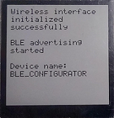

    > Note:
    > The Dev Kit (BRD2605A) and Explorer Kit (BRD2708A) do not support display functionality.

    It implies that an older version of OOB demo binary (older than v2.0) is running on the SiWG917 board. 
    
    It is recommended to upgrade to the latest OOB demo binary (With the application binaries older than v2.0, there's a possibility of observing issues with MQTT data transfer, as the test MQTT server limits multiple devices with same CLIENT ID from connecting at the same time. This has been fixed in the application binary v2.0).

    To upgrade to latest application binary, refer [upgrade application binary](#upgrade-application-binary) section.

    Also, upgrade the connectivity firmware (NWP firmware) to the latest version to avoid compatibility issues with application binary. Download the latest connectivity firmware from [Wiseconnect github repository](https://github.com/SiliconLabs/wiseconnect/tree/v4.2.0-content-for-docs/connectivity_firmware) and refer [Upgrade SiWx91x Connectivity Firmware](https://docs.silabs.com/wiseconnect/latest/wiseconnect-developers-guide-developing-for-silabs-hosts/#upgrade-si-wx91x-connectivity-firmware)  to upgrade the connectivity firmware.

    If the messages being displayed on the LCD display on WPK or the serial terminal prints indicate versioning information (Si917 OOB Demo v2.0 - as show in the following image)

    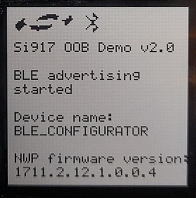

    It implies that OOB demo binary v2.0 (latest application binary) is running on the SiWG917 board. Proceed to the next steps of the demo.

- Once the application is flashed or the SiWG917 board is powered up, the Wireless interface is initialized.
- After the Wireless initialization, the module starts BLE advertising and advertises itself as "BLE_CONFIGURATOR"
- The status of the application can be observed on the TFT-LCD display on the WPK baseboard or the serial terminal prints.
- Following is the image of LCD display indicating the application status.

  If application binary is older than v2.0:

  

  If application binary version is v2.0 (latest):

  

  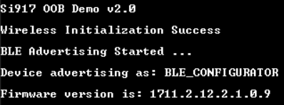

- Open the Simplicity Connect App (formerly EFR Connect App) on your mobile phone.

  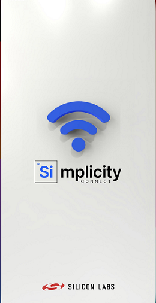

- Go to 'Demo' tab.

  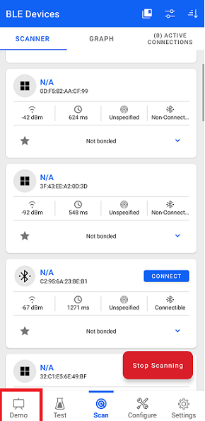

- Choose the Wi-Fi commissioning option.

  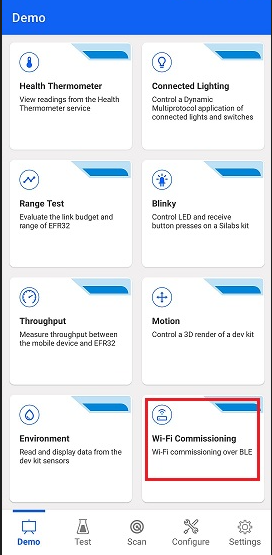

- Click on the device name "BLE_CONFIGURATOR".

  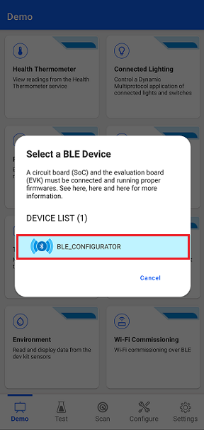

  **NOTE:** For the Wi-Fi commissioning demo, EFR connect mobile app displays the devices which advertise as "BLE_CONFIGURATOR" only. This is to filter out the other Bluetooth devices in the vicinity and if the device name is modified, it won't be detected in the EFR connect mobile app for Wi-Fi commissioning demo.

- A list of the available Access points is displayed in the mobile app.

  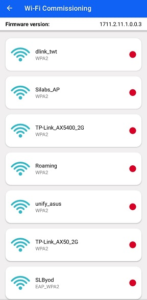

- Choose the desired access point and enter the password.

  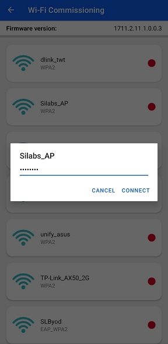

- The module is now commissioned into the Wi-Fi network.

  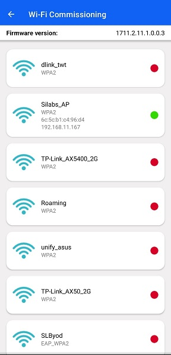

- The module starts to ping www.silabs.com.
- After pinging, the module now establishes connectivity with test.mosquitto.org.
- Here is the image of LCD with the status prints.

  If Application binary is older than v2.0

  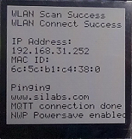

  If Application binary version is v2.0 (latest)

  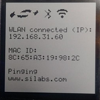

  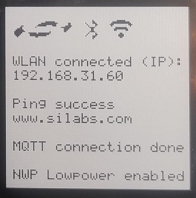

  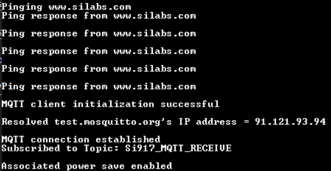

- NWP (network processor of SiWG917) enters connected sleep.  

- To connect to a working MQTT broker and update the mqtt_hostname in the `wifi_app.c` file, follow these steps:

### Update MQTT Hostname in wifi_app.c

- By default, the mqtt_hostname in the `wifi_app.c` file is set to "test.mosquitto.org".
  
  ```c
  char *mqtt_hostname = "test.mosquitto.org";     
  ```

- If you are using a different MQTT broker, replace "test.mosquitto.org" with the appropriate hostname.

- To check if the MQTT broker is working, you can use the online MQTT client.

- Press BTN0 on the WPK baseboard or dev kit. When BTN0 is pressed, SiWG917 publishes a MQTT message saying "Button is pressed" onto the topic "Si917_APP_STATUS". The same can be observed in the LCD display of the baseboard and the MQTT client page.

  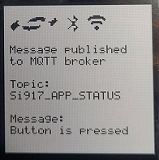

  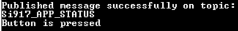

- The current consumption of SiWG917 can observed using the energy profiler tool integrated within the Simplicity Studio. Refer the [Measuring the current consumption using Simplicity Studio Energy Profiler](#measuring-the-current-consumption-using-simplicity-studio-energy-profiler) section for using the energy profiler to measure the current consumption of the module.

- To view the prints on the console, follow the instructions [here](https://docs.silabs.com/wiseconnect/latest/wiseconnect-developers-guide-developing-for-silabs-hosts/#console-input-and-output).

    If application binary version is older than v2.0, the application prints would be as follows:

    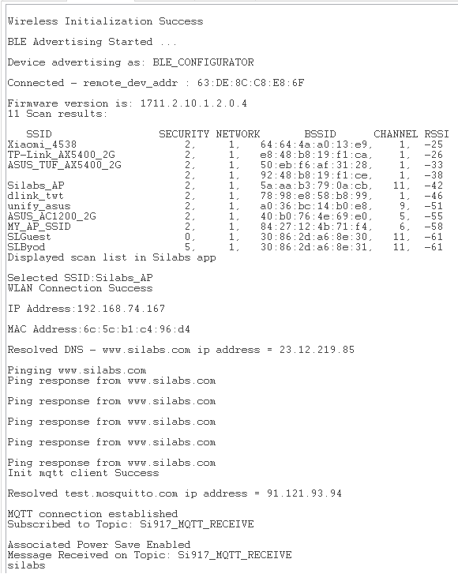

    If application binary version is v2.0, the application prints would be as follows:

    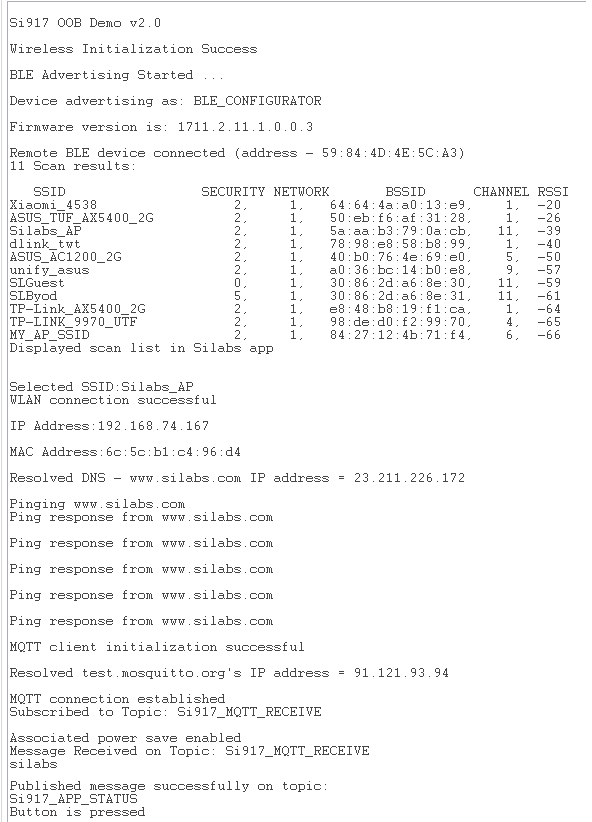

### Measuring the current consumption using Simplicity Studio Energy Profiler

To open the energy profiler:

- Open the "Tools" section from the toolbar.

  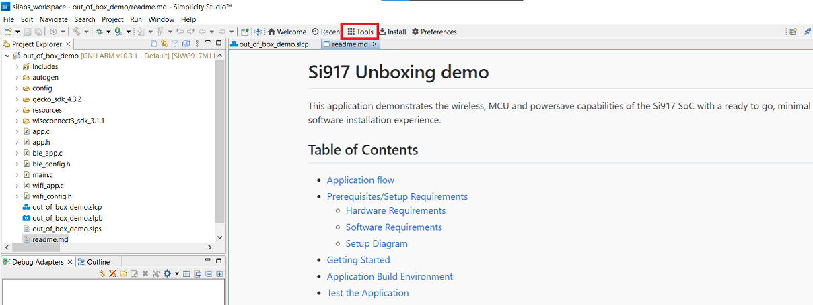

- Choose the "Energy Profiler" from the tools dialog box.

  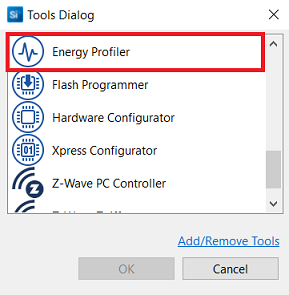

- Click on the "Quick Access" option and choose "Start Energy Capture" option.

  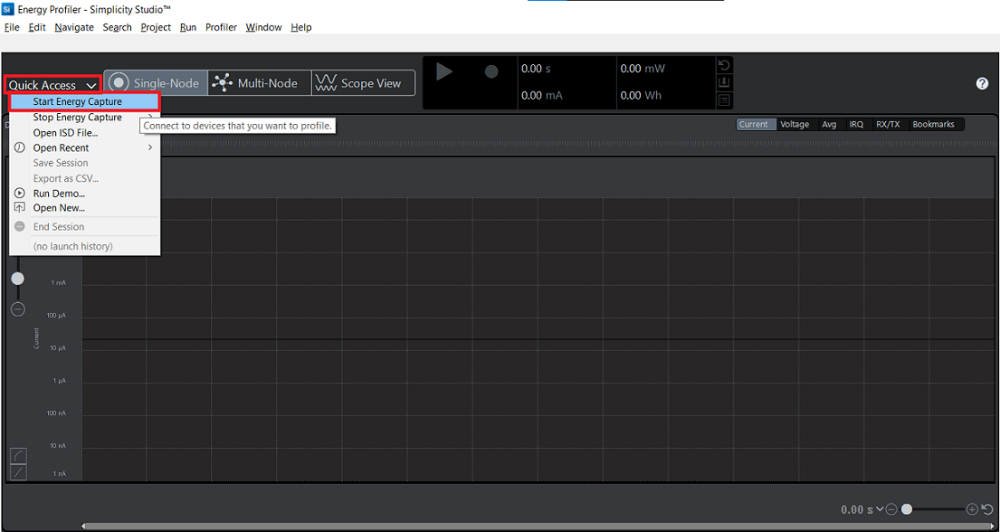

- Click on the device name and click on OK.

  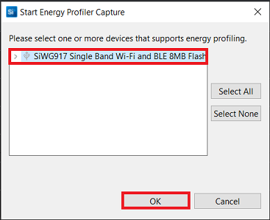

- The energy profiler session begins and the current consumption plot can be observed.

- The energy consumption plot would be as follows:

  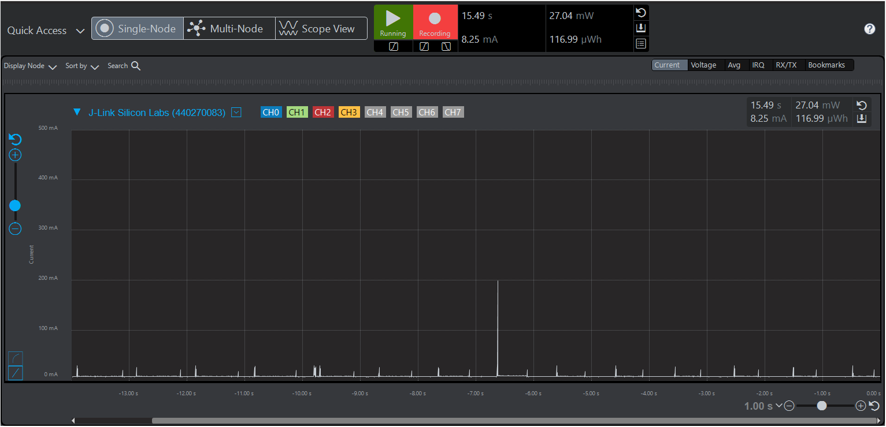

- Please note that

  - Current consumption would be in the range of 8mA-9mA since M4 is in active state.
  - The above energy consumption plots are for reference and the power consumption number would vary based on the on air traffic, environment and the access point used.

## Troubleshooting

If you encounter issues while running this example, check the following:

- Use the SiWG917 dev kit or WPK with the correct pre-built binary for your board.
- Update the MQTT hostname in `wifi_app.c` as described in [Update MQTT Hostname in wifi_app.c](#update-mqtt-hostname-in-wifi_appc).
- For Energy Profiler measurements, follow the steps in [Measuring the current consumption using Simplicity Studio Energy Profiler](#measuring-the-current-consumption-using-simplicity-studio-energy-profiler).


## Resources

- [WiSeConnect Getting Started Guide](https://docs.silabs.com/wiseconnect/latest/wiseconnect-getting-started/)
- [WiSeConnect Examples](https://docs.silabs.com/wiseconnect/latest/wiseconnect-examples/#example-folder-structure)
- [WiSeConnect Recommended Settings Guide](https://docs.silabs.com/wiseconnect/latest/wiseconnect-developers-guide-prog-recommended-settings/)

## Report Bugs and Get Support

You are always encouraged and welcome to report any issues you found to us via [Silicon Labs Community](https://www.silabs.com/community).
